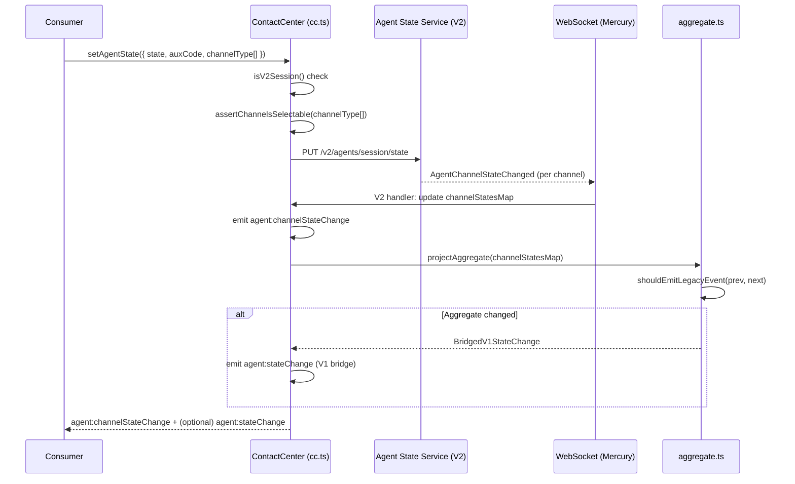

# Feature Design — WXCC-15791: Granular Agent State Control V2 (Widgets)

> **Navigation:** [AGENTS.md](../../../AGENTS.md) → [SPEC_INDEX.md](../../../SPEC_INDEX.md) → [ARCHITECTURE.md](../../../ARCHITECTURE.md)

> Start here → repo [`AGENTS.md`](../../../../AGENTS.md) · router [`SPEC_INDEX.md`](../../../SPEC_INDEX.md). Implements [`../spec/feature-spec.md`](../spec/feature-spec.md); contracts [`contracts/`](./contracts/); tasks [`../tasks/widgets-v2-channel-availability/epic.md`](../tasks/widgets-v2-channel-availability/epic.md).

## Metadata
| Field | Value |
|---|---|
| Feature key | WXCC-15791 |
| Status | implementation-ready |
| Change class | contract-affecting + ui |
| Generated from | `feature-design` @ SDLC template library `0.2.0` |

## Executive Summary
A new V2 widget is added as a standalone package that mirrors the existing V1 `user-state` widget hierarchy: a presentational layer in `@webex/cc-components` (`GranularAgentState/`), a container package `@webex/cc-granular-agent-state` (observer widget + `ErrorBoundary` gate + hook), and r2wc registration in `@webex/cc-widgets`. The MobX store gains a small additive V2 surface. The V1 `user-state` widget is untouched; the host renders V1 or V2 based on `store.isGranularAgentStateActive`.

## Scenario → Design Map
| Scenario (spec) | Design element |
|---|---|
| Reactive per-channel state (W-R-1) | store `channelStatesMap`/`isGranularAgentStateActive` + `refreshAgentStateControl()` wired in `storeEventsWrapper.ts` |
| Batched state change (W-R-2) | `useGranularAgentState` → `cc.setAgentState({channelType[]})` |
| Manage view + toggles (W-R-3..R-7) | `GranularAgentState/manage-channel-availability.tsx` + utils |
| V2 gate (W-R-8) | `granular-agent-state/index.tsx` observer gate on `store.isGranularAgentStateActive` |
| Registration (W-R-9) | `cc-widgets/src/wc.ts` r2wc + `index.ts` export |
| Pill/preview/menu (W-R-11/12) | `granular-agent-state.tsx`, `channel-state-preview.tsx`, `granular-state-menu.tsx` |

## System Context
Host → `@webex/cc-widgets` (web components / React) → widget packages → `@webex/cc-components` (presentational) + `@webex/cc-store` (MobX, the only SDK gateway). The store wraps the SDK `cc` instance and re-reads V2 getters on lifecycle/events.

## Functional-Block Decomposition
- **Store V2 surface** (`store/src/store.ts`, `store.types.ts`, `storeEventsWrapper.ts`): observables + `refreshAgentStateControl()`; `agent:channelStateChange`/`agent:channelReloginSuccess` wiring; getters on the `StoreWrapper`; reset in `cleanUpStore`.
- **Presentational** (`cc-components/src/components/GranularAgentState/`): `granular-agent-state.tsx` (pill, `withMetrics`, `formatTime`), `channel-avatar.tsx`, `channel-state-preview.tsx`, `granular-state-menu.tsx`, `manage-channel-availability.tsx`; `granular-agent-state.utils.ts`; `constant.ts`; types.
- **Container package** (`granular-agent-state/`): `granular-agent-state/index.tsx` (mobx-react-lite `observer` + `react-error-boundary` gate on `store.isGranularAgentStateActive`), `helper.ts` (`useGranularAgentState` hook + 1 s tick Web Worker), `granular-agent-state.types.ts`, `index.ts`.
- **Registration** (`cc-widgets/`): `wc.ts` r2wc `widget-cc-granular-agent-state`, `index.ts` re-export, `package.json` dep.

## Object-Model Changes
Store adds `isGranularAgentStateActive: boolean`, `channelStatesMap: Partial<Record<ChannelType, AgentChannelTypeStates>>`, and `refreshAgentStateControl(): void`; `store.types.ts` re-exports the SDK V2 types and declares optional V2 getters on `IContactCenter` + the new fields on `IStore`; `CC_EVENTS` gains `AGENT_CHANNEL_STATE_CHANGE`/`AGENT_CHANNEL_RELOGIN_SUCCESS`. Per-channel capacity is available via `channelStatesMap[channelType].totalChannelCount`.

## Design Decisions & Rationale
| Decision | Rationale |
|---|---|
| New package `@webex/cc-granular-agent-state`, V1 `user-state` untouched | Clean separation; V1 agents see zero change; independent versioning/testing |
| Follow the exact V1 widget hierarchy (components → package → r2wc) | Consistency and easy human review |
| Hook calls `cc.setAgentState({channelType})` directly (no store `setAgentStateV2`) | Same pattern as `useUserState`; the SDK routes by session version |
| Gate only on `store.isGranularAgentStateActive` | The SDK already pins the version; a second flag could disagree |
| `refreshAgentStateControl()` reads both getters (`getAgentStateControl`, `getChannelStates`) then publishes once | Avoid a partially-updated posture; keep previous values on getter throw |
| Keep `formatDuration` util (hh:mm:ss) alongside shared `formatTime` | Not equivalent; preview needs always-hh:mm:ss |
| Relogin handled via `agent:channelReloginSuccess` in listener bootstrap | A V2 reload emits only that event; it must also set profile/team + refresh |

## Alternatives Explored
- Extend the V1 `user-state` widget in place → rejected (would change V1 UI/behavior; user explicitly wanted a separate V2 widget).
- A `setAgentStateV2` store action → rejected (duplicates the SDK's version routing).

## Impacted Services / Modules & Task Split
| Module | Change | Task |
|---|---|---|
| `cc-components/GranularAgentState` + `index.ts` | components + exports | W1 |
| `store` (`store.ts`/`store.types.ts`/`storeEventsWrapper.ts`) + `granular-agent-state` package + `cc-widgets` | V2 store surface + widget + r2wc | W2 |
| tests + sample app | unit tests + sample integration | W3 |

## Interface & Contract Definitions
See [`contracts/store-v2-surface.md`](./contracts/store-v2-surface.md) and [`contracts/granular-agent-state-widget.md`](./contracts/granular-agent-state-widget.md).

## UX Design & Traceability
Pill + hover preview + state menu + manage view; only channels with capacity > 0; Momentum tokens. Parity reference: wxcc-desktop `GranularStateSelector*`. Parity exceptions (this iteration): no `pendingIdle`/RONA/WebRTC-disconnect visuals, English labels, client-side idle-code filter — listed in release notes.

## HA & Failure-Condition Matrix
| Condition | Handling |
|---|---|
| State change fails | Store logs `agent:channelStateChangeFailed`; no optimistic mutation |
| Getter throws in refresh | Keep previous values; single-publish rule |
| Component error | `ErrorBoundary` empty fallback + `store.onErrorCallback('GranularAgentState', err)` |
| V1 session | Widget renders null |

## Rollout / Migration Interlock
Additive; gated by `store.isGranularAgentStateActive` (SDK session version). Coexists with V1. Rollback = disable profile flag / remove the new package. Release order: SDK → store → components → widget → cc-widgets.

## Test Strategy
See [`../test-strategy.md`](../test-strategy.md): store-surface unit tests, component/hook RTL tests, widget gate tests, build chain across the four packages.

## Design Coverage Summary
| Requirement | Design element | Covered |
|---|---|---|
| W-R-1 | store V2 surface + wiring | ✅ |
| W-R-2 | `useGranularAgentState` | ✅ |
| W-R-3..7 | manage view + utils | ✅ |
| W-R-8 | observer gate | ✅ |
| W-R-9 | r2wc + export | ✅ |
| W-R-10 | sample app | follow-up, not in this change |
| W-R-11/12 | pill/preview/menu | ✅ |

## References / Traceability
- Spec: [`../spec/feature-spec.md`](../spec/feature-spec.md) · contracts: [`contracts/`](./contracts/) · tests: [`../test-strategy.md`](../test-strategy.md)
- SDK feature: `webex-js-sdk/packages/@webex/contact-center/ai-docs/features/WXCC-15791-user-granular-agent-state/`

## Feature-Toggle Strategy

Granular agent state is controlled by the `manageChannelAvailability` flag on the agent profile.
- When `true` (or host-declared eligible), the SDK pins the session to V2 and uses per-channel endpoints.
- When `false` or absent, the SDK falls back to V1 agent-wide state management.
- The toggle is evaluated once at login and cannot change mid-session.
- Widget rendering is gated by `store.isGranularAgentStateActive`.

## Service Impact Matrix

| Service | Impact | Notes |
|---|---|---|
| Agent State Service | V2 endpoints added | `/v2/agents/login`, `/v2/agents/session/state`, `/v2/agents/reload`, `/v2/agents/logout` |
| WebSocket (AQM) | New event types | `AgentChannelStateChanged`, `AgentChannelStateChangeFailed`, `AgentChannelReloginSuccess` |
| Agent Profile Service | Feature flag read | `manageChannelAvailability` field |
| Existing V1 consumers | No breaking changes | V1 events continue via aggregate bridge |

## V2 State Change Flow

## Reviewer Sign-Off

| Role | Name | Date | Status |
|---|---|---|---|
| Author | | | Pending |
| Technical Reviewer | | | Pending |
| Product Owner | | | Pending |
