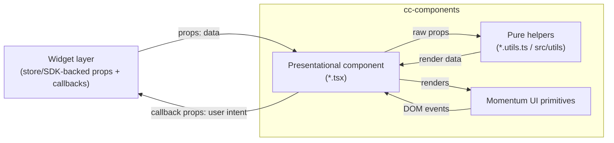
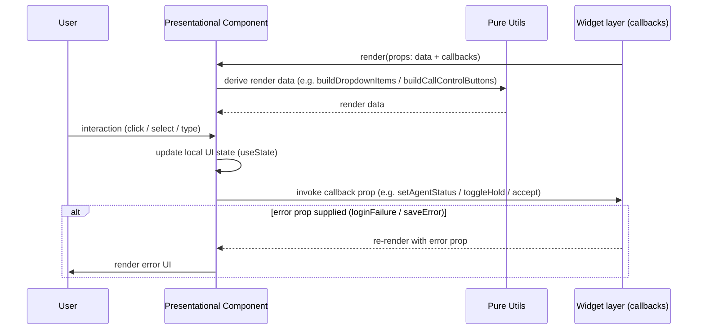
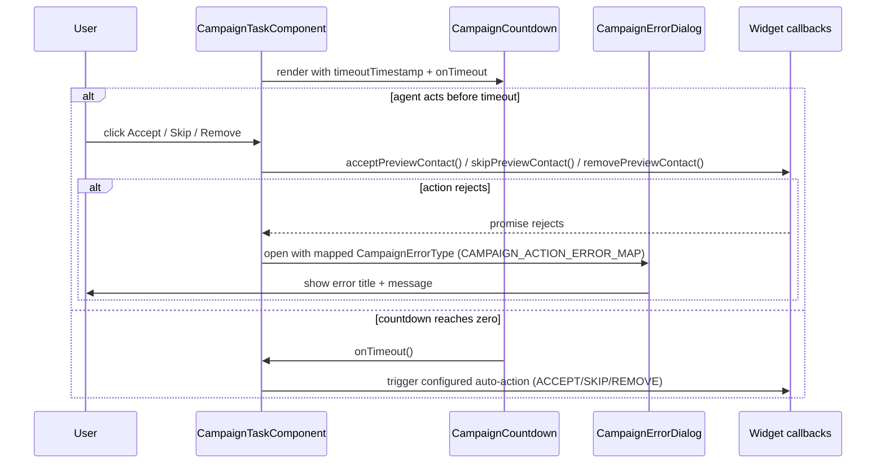
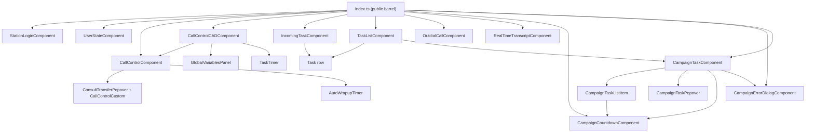

Warning: truncated output (original token count: 30677)
Total output lines: 373

# cc-components — SPEC

> Start here → root [`AGENTS.md`](../../../../AGENTS.md) (agent entry) · router [`SPEC_INDEX.md`](../../../../ai-docs/SPEC_INDEX.md) · system [`ARCHITECTURE.md`](../../../../ai-docs/ARCHITECTURE.md). This is the module's canonical spec: orientation, requirements, design, flows, UI, and tests.
> Context-efficiency: link to canonical docs — don't duplicate them. Load specs on demand per `SPEC_INDEX.md`.

## Metadata

| Field                                   | Value                                                                            |
| --------------------------------------- | -------------------------------------------------------------------------------- |
| Module id                               | `cc-components`                                                                  |
| Source path(s)                          | `packages/contact-center/cc-components/src/`                                     |
| Doc kind                                | Module spec                                                                      |
| Coverage score                          | Pending coverage assessment                                                      |
| Generated from                          | `module-spec` @ SDLC template library `0.1.0-draft`                              |
| generated_by / approved_by / updated_at | generated_by `migration agent` / approved_by `pending` / updated_at `2026-09-04` |
| Validation status                       | not-run                                                                          |

## Evidence Rules

Every generated requirement below cites concrete source evidence using `file path`. Source evidence, test evidence, examples, assumptions, and gaps are kept separate so validators and future agents can distinguish truth from context. Test evidence is preferred for WHY. This repository's tests are the authoritative behavior record; commit history is not cited here. Where evidence is missing it is recorded as a gap rather than asserted.

## Source Material Register

| Source doc                                                                                          | Scope                          | Decision                      | Detail location or disposition                                                                                                                                                                                                                                                                |
| --------------------------------------------------------------------------------------------------- | ------------------------------ | ----------------------------- | --------------------------------------------------------------------------------------------------------------------------------------------------------------------------------------------------------------------------------------------------------------------------------------------- |
| `ai-docs/_archive/pre-sdlc-migration/packages/contact-center/cc-components/ai-docs/AGENTS.md`       | overview / API / examples      | migrated / reconciled         | Orientation → Overview/Purpose/Stack; component table → Public Surface; examples → Use Cases. Reconciled: archived table listed 7 components; code exports 11 (added Campaign\* and RealTimeTranscript).                                                                                      |
| `ai-docs/_archive/pre-sdlc-migration/packages/contact-center/cc-components/ai-docs/ARCHITECTURE.md` | architecture / component table | migrated / reconciled         | Component table, file structure, patterns, diagrams → Design Overview, Data Flow, Class/Component Relationships, Folder structure, Pitfalls. Conflict: archived doc imports `@momentum-design/components` and `@momentum-ui/react-collaboration` interchangeably; code uses both (see Stack). |
| `packages/contact-center/cc-components/src/` and `tests/`                                           | source / tests                 | reference-only (ground truth) | All requirements, props, and component inventory grounded against live source and `tests/components/`.                                                                                                                                                                                        |

## Overview

`cc-components` is the presentation layer for Webex Contact Center widgets. It is a library of pure, presentational React function components — each receives all data and callbacks via props and renders Momentum UI primitives. Components do not import or read the MobX store, do not call the SDK, and hold only transient local UI state (open/closed menus, selected dropdown values, input text). Business logic and store/SDK access live one layer up, in the widget packages (`station-login`, `user-state`, `task`) that compose these components.

The package exports two surfaces from `src/index.ts` (React components + their prop types) and `src/wc.ts` (the same components wrapped as custom elements via `@r2wc/react-to-web-component`). A maintainer should start at `src/index.ts` to see the public component set, then open the component directory under `src/components/` (each has `*.tsx`, a `*.types.ts` or shared `task.types.ts`, a `*.utils.ts(x)` for extracted logic, and a `*.scss`). Shared, cross-component logic lives in `src/utils/index.ts` (`formatTime`, `getMediaTypeInfo`, `isWxAppEngagedCall`, `shouldShowWxAppTelephonyControls`) and `src/hooks/` (`useIntersectionObserver`). `@webex/cc-task` imports the wxApp visibility helpers from this package's public export.

The component set spans the contact-center agent surface: station login (including the E911 emergency-service acknowledgment modal), agent state, the task lifecycle (incoming task, call control with consult/transfer, CAD-enabled call control, task list, outdial), live transcript, and campaign-preview dialing (countdown, error dialog, campaign task card/popover/list-item).

## Purpose / Responsibility

Owns the presentational React UI primitives for contact-center widgets: render agent/task UI from props and emit user intent back through callback props. Does NOT own state management, SDK access, business logic, or web-component registration into the host (the actual custom-element registration into the host app is `cc-widgets`' responsibility; `wc.ts` here only defines `component-cc-*` elements for the library build).

## Stack

TypeScript 5.6, React 18 (peer `react`/`react-dom` `>=18.3.1`), function components with hooks. UI primitives from `@momentum-ui/react-collaboration` (peer `>=26.197.0`) and `@momentum-design/components/dist/react`. Web-component wrapping via `@r2wc/react-to-web-component` `2.0.3`. Metrics via `@webex/cc-ui-logging` (`withMetrics` HOC). Types consumed from `@webex/cc-store`. Test stack: Jest 29 + React Testing Library 16 + `@testing-library/jest-dom`, jsdom environment, snapshot tests alongside behavioral tests. Build: `tsc` for the type build, Webpack 5 for the bundle. Test command: `yarn workspace @webex/cc-components test:unit`.

## Folder / Package Structure

```
packages/contact-center/cc-components/src/
├── index.ts                          # React component + type barrel (public surface)
├── wc.ts                             # Custom-element (r2wc) wrappers — defines component-cc-* elements
├── hooks/
│   ├── index.ts                      # Hook barrel
│   └── useIntersectionObserver.ts    # Infinite-scroll / lazy-load observer hook
├── utils/
│   └── index.ts                      # Shared utils: formatTime, getMediaTypeInfo
└── components/
    ├── StationLogin/                 # Agent login / device + team selection UI
    ├── UserState/                    # Agent state dropdown, idle codes, state timer
    └── task/
        ├── constants.ts              # Shared task UI label/string constants
        ├── task.types.ts            # Shared task prop/types + component prop Picks
        ├── Task/                     # Generic task row (shared by IncomingTask & TaskList)
        ├── IncomingTask/             # Incoming task notification (Answer/Decline)
        ├── TaskList/                 # Active/incoming task list
        ├── CallControl/              # Call control buttons (hold/mute/record/end/wrapup)
        │   ├── call-control-dtmf-keypad.tsx  # In-call DTMF keypad (wxApp telephony)
        │   └── CallControlCustom/    # Consult/Transfer popover, list items, dial-number, consult bar
        ├── CallControlCAD/           # CAD-enabled call control header (customer/queue/CAD vars)
        ├── OutdialCall/              # Outbound dialpad + ANI/address-book selection
        ├── RealTimeTranscript/       # Live transcript renderer
        ├── AutoWrapupTimer/          # Auto-wrapup countdown bar
        ├── TaskTimer/                # Generic elapsed/urgency timer
        ├── GlobalVariablesPanel/     # Agent-viewable CAD global variables panel
        ├── CampaignCountdown/        # Campaign preview offer countdown
        ├── CampaignErrorDialog/      # Campaign action-failure dialog
        └── CampaignTask/             # Campaign preview card
            ├── CampaignTaskListItem/ # Shared campaign row (avatar/title/countdown/actions)
            └── CampaignTaskPopover/  # Hover popover with campaign global variables
tests/components/                     # Mirrors src; behavioral + *.snapshot tests + __snapshots__
tests/hooks/                          # Hook tests
```

## Key Files (source of truth)

| File                                                 | Holds                                                                                                                                                                                                                                                                                                   |
| ---------------------------------------------------- | ------------------------------------------------------------------------------------------------------------------------------------------------------------------------------------------------------------------------------------------------------------------------------------------------------- |
| `src/index.ts`                                       | The public React component set and re-exported type barrels — authoritative export list.                                                                                                                                                                                                                |
| `src/wc.ts`                                          | Custom-element tag names (`component-cc-*`) and the r2wc prop type maps per component.                                                                                                                                                                                                                  |
| `src/components/task/task.types.ts`                  | Shared task prop interfaces and the `Pick`-derived component prop types (`CallControlComponentProps`, `IncomingTaskComponentProps`, `TaskListComponentProps`, `OutdialCallComponentProps`, `RealTimeTranscriptComponentProps`), plus `MEDIA_CHANNEL`, `TaskState`, `ControlVisibility`, campaign types. |
| `src/components/StationLogin/station-login.types.ts` | `IStationLoginProps` and the `StationLoginComponentProps` Pick.                                                                                                                                                                                                                                         |
| `src/components/UserState/user-state.types.ts`       | `IUserState`, `UserStateComponentsProps` Pick, `AgentUserState` enum.                                                                                                                                                                                                                                   |
| `src/components/StationLogin/constants.ts`           | Login labels/error strings — re-exported from the barrel; never hardcode these elsewhere.                                                                                                                                                                                                               |
| `src/components/task/constants.ts`                   | Task UI label/string constants (e.g. `CAMPAIGN_CALL`, `WRAP_UP`).                                                                                                                                                                                                                                       |
| `src/utils/index.ts`                                 | `formatTime` (timer formatting), `getMediaTypeInfo` (media icon/label mapping), and wxApp telephony visibility helpers (`isWxAppEngagedCall`, `shouldShowWxAppTelephonyControls` in `wxapp-telephony.utils.ts`, re-exported from package index).                                                        |

## Public Surface

Consumed as an imported SDK/code API. The React barrel (`src/index.ts`) is the primary surface; `src/wc.ts` exposes the same components as custom elements for the library build. Exact prop schemas live in the `*.types.ts` files (linked below); the root contract index (`CONTRACTS.md`) documents how the consuming `cc-widgets`/widget layer re-exposes these as custom elements.

| Contract ID                                  | Type               | Surface                                                                                                                                                                                                                                                                                     | Purpose                                                                                                                                                                                                                                                                                                                                                                                                                | Compatibility / deprecation                                                                         | Schema / detail link                                                     | Root index                                         |
| -------------------------------------------- | ------------------ | ------------------------------------------------------------------------------------------------------------------------------------------------------------------------------------------------------------------------------------------------------------------------------------------- | ---------------------------------------------------------------------------------------------------------------------------------------------------------------------------------------------------------------------------------------------------------------------------------------------------------------------------------------------------------------------------------------------------------------------- | --------------------------------------------------------------------------------------------------- | ------------------------------------------------------------------------ | -------------------------------------------------- |
| `cc-components.StationLoginComponent`        | SDK                | `StationLoginComponent` (`StationLoginComponentProps`)                                                                                                                                                                                                                                      | Agent login: device/team selection, login/logout, multiple-login alert, profile mode                                                                                                                                                                                                                                                                                                                                   | semver; props are `Pick`ed — adding optional props = minor, removing/renaming a picked prop = major | `src/components/StationLogin/station-login.types.ts`                     | [`CONTRACTS.md`](../../../../ai-docs/CONTRACTS.md) |
| `cc-components.UserStateComponent`           | SDK                | `UserStateComponent` (`UserStateComponentsProps`)                                                                                                                                                                                                                                           | Agent state dropdown + idle codes + state timer                                                                                                                                                                                                                                                                                                                                                                        | semver as above                                                                                     | `src/components/UserState/user-state.types.ts`                           | [`CONTRACTS.md`](../../../../ai-docs/CONTRACTS.md) |
| `cc-components.CallControlComponent`         | SDK                | `CallControlComponent` (`CallControlComponentProps`)                                                                                                                                                                                                                                        | Call control buttons: hold/resume, mute, record, end, wrapup, consult/transfer/conference                                                                                                                                                                                                                                                                                                                              | semver as above                                                                                     | `src/components/task/task.types.ts`                                      | [`CONTRACTS.md`](../../../../ai-docs/CONTRACTS.md) |
| `cc-components.consult-transfer-lists`       | SDK callback props | `getQueuesFetcher`/`getQueues` use `FetchPaginatedList<ContactServiceQueue>` and `getEntryPoints` uses `FetchPaginatedList<EntryPointRecord>`                                                                                                                                               | Render the SDK's established queue and entry-point records directly in backend order                                                                                                                                                                                                                                                                                                                                   | types track the existing SDK/store entity contracts                                                 | `src/components/task/task.types.ts`                                      | [`CONTRACTS.md`](../../../../ai-docs/CONTRACTS.md) |
| `cc-components.CallControlCADComponent`      | SDK                | `CallControlCADComponent` (`CallControlComponentProps`)                                                                                                                                                                                                                                     | Call control with customer/queue header and agent-viewable CAD global variables                                                                                                                                                                                                                                                                                                                                        | semver as above                                                                                     | `src/components/task/task.types.ts`                                      | [`CONTRACTS.md`](../../../../ai-docs/CONTRACTS.md) |
| `cc-components.IncomingTaskComponent`        | SDK                | `IncomingTaskComponent` (`IncomingTaskComponentProps`)                                                                                                                                                                                                                                      | Incoming task notification with Answer/Decline                                                                                                                                                                                                                                                                                                                                                                         | semver as above                                                                                     | `src/components/task/task.types.ts`                                      | [`CONTRACTS.md`](../../../../ai-docs/CONTRACTS.md) |
| `cc-components.TaskListComponent`            | SDK                | `TaskListComponent` (`TaskListComponentProps`)                                                                                                                                                                                                                                              | Active + incoming task list; renders campaign preview when enabled                                                                                                                                                                                                                                                                                                                                                     | semver as above                                                                                     | `src/components/task/task.types.ts`                                      | [`CONTRACTS.md`](../../../../ai-docs/CONTRACTS.md) |
| `cc-components.OutdialCallComponent`         | SDK                | `OutdialCallComponent` (`OutdialCallComponentProps`)                                                                                                                                                                                                                                        | Outbound dialpad, ANI selection, address-book search                                                                                                                                                                                                                                                                                                                                                                   | semver as above                                                                                     | `src/components/task/task.types.ts`                                      | [`CONTRACTS.md`](../../../../ai-docs/CONTRACTS.md) |
| `cc-components.RealTimeTranscriptComponent`  | SDK                | `RealTimeTranscriptComponent` (`RealTimeTranscriptComponentProps`)                                                                                                                                                                                                                          | Renders sorted live transcript entries; empty state when none                                                                                                                                                                                                                                                                                                                                                          | semver as above                                                                                     | `src/components/task/task.types.ts`                                      | [`CONTRACTS.md`](../../../../ai-docs/CONTRACTS.md) |
| `cc-components.CampaignCountdownComponent`   | SDK                | `CampaignCountdownComponent` (`CampaignCountdownProps`)                                                                                                                                                                                                                                     | Campaign preview offer countdown; fires `onTimeout` at zero                                                                                                                                                                                                                                                                                                                                                            | semver as above                                                                                     | `src/components/task/CampaignCountdown/campaign-countdown.types.ts`      | [`CONTRACTS.md`](../../../../ai-docs/CONTRACTS.md) |
| `cc-components.CampaignErrorDialogComponent` | SDK                | `CampaignErrorDialogComponent` (`CampaignErrorDialogProps`)                                                                                                                                                                                                                                 | Modal shown when a campaign action (accept/skip/remove/cancel) fails                                                                                                                                                                                                                                                                                                                                                   | semver as above                                                                                     | `src/components/task/CampaignErrorDialog/campaign-error-dialog.types.ts` | [`CONTRACTS.md`](../../../../ai-docs/CONTRACTS.md) |
| `cc-components.CampaignTaskComponent`        | SDK                | `CampaignTaskComponent` (`CampaignTaskProps`)                                                                                                                                                                                                                                               | Campaign preview card: accept/skip/remove, countdown, error dialog                                                                                                                                                                                                                                                                                                                                                     | semver as above                                                                                     | `src/components/task/task.types.ts`                                      | [`CONTRACTS.md`](../../../../ai-docs/CONTRACTS.md) |
| `cc-components.E911Modal`                    | SDK                | `E911Modal` (`E911ModalProps`)                                                                                                                                                                                                                                                              | Emergency-service (E911) acknowledgment modal shown on BROWSER station login; Cancel is the only dismissal path, Save & Continue is gated on the checkbox and disabled while the save is in flight                                                                                                                                                                                                                     | semver as above; not yet in `wc.ts` (React-only, no custom-element wrapper)                         | `src/components/StationLogin/E911Modal/e911-modal.types.ts`              | [`CONTRACTS.md`](../../../../ai-docs/CONTRACTS.md) |
| `cc-components.TelephonyActionToast`         | SDK                | `TelephonyActionToast` (`TelephonyActionToastProps`)                                                                                                                                                                                                                                        | wxApp thick-client telephony error toast (Momentum `Toast` `variant="error"`); consumed by `@webex/cc-task` CallControl / CallControlCAD wrappers, not intended for third-party host apps                                                                                                                                                                                                                              | semver; widget-internal surface — exported from package index for cross-package use                 | `src/components/task/TelephonyActionToast/telephony-action-toast.tsx`    | [`CONTRACTS.md`](../../../../ai-docs/CONTRACTS.md) |
| `cc-components.WxAppOfferActionError`        | SDK                | `WxAppOfferActionError` (`WxAppOfferActionErrorProps`)                                                                                                                                                                                                                                      | Inline wxApp offer-action error as red text (`--mds-color-theme-text-error-normal`) on a full-width row below Accept/Decline — no alert background, padding, or border; parent `Task` sets `ListItemBase size="auto"` when an error is present so the row grows naturally; store-backed per `interactionId`, shared between TaskList and IncomingTask via `@webex/cc-store` (immutable map updates for memo-safe sync) | semver; widget-internal surface — exported from package index for cross-package use                 | `src/components/task/WxAppOfferActionError/wxapp-offer-action-error.tsx` | [`CONTRACTS.md`](../../../../ai-docs/CONTRACTS.md) |
| `cc-components.wxapp-telephony-utils`        | SDK                | `isWxAppEngagedCall`, `shouldShowWxAppTelephonyControls`                                                                                                                                                                                                                                    | Shared wxApp visibility helpers for mute/keypad gating across cc-components and cc-task                                                                                                                                                                                                                                                                                                                                | semver; utility exports from `src/utils/wxapp-telephony.utils.ts`                                   | `src/utils/wxapp-telephony.utils.ts`                                     | [`CONTRACTS.md`](../../../../ai-docs/CONTRACTS.md) |
| `cc-components.wc`                           | SDK                | `@webex/cc-components/wc` → custom elements `component-cc-user-state`, `component-cc-station-login`, `component-cc-call-control`, `component-cc-call-control-cad`, `component-cc-incoming-task`, `component-cc-task-list`, `component-cc-out-dial-call`, `component-cc-realtime-transcript` | Custom-element build of the components                                                                                                                                                                                                                                                                                                                                                                                 | tag names are breaking surface; r2wc prop type map is part of the contract                          | `src/wc.ts`                                                              | [`CONTRACTS.md`](../../../../ai-docs/CONTRACTS.md) |

Compatibility notes:

- Component props are derived with `Pick<...>` over a larger interface (e.g. `IStationLoginProps`, `ControlProps`); only the picked keys are public. Adding an optional picked prop is additive (minor); removing/renaming a picked prop, or narrowing a prop's type, is breaking (major).
- Custom-element tag names in `wc.ts` (`component-cc-*`) and their r2wc prop type maps are a breaking surface — renaming a tag or changing a prop's r2wc type (`json`/`string`/`function`/...) breaks host consumers.
- `wc.ts` aliases `CallControlCADComponent` to `../CallControl/call-control` (imports `CallControlComponent` under the `CallControlCADComponent` name); the distinct CAD component is `src/components/task/CallControlCAD/call-control-cad.tsx`. See Pitfalls.

## Requires (dependencies)

- `@webex/cc-store` (workspace:\*) — type-only import surface here (`ITask`, `ILogger`, `IContactCenter`, `ContactServiceQueue`, `EntryPointRecord`, `IdleCode`, `IWrapupCode`, `BuddyDetails`, etc.) and constants such as `ERROR_TRIGGERING_IDLE_CODES`, `LoginOptions`, `DESKTOP`. Components consume types/constants, not the store singleton.
- `@webex/cc-ui-logging` (workspace:\*) — `withMetrics` HOC wrapping each top-level component for mount/metrics tracking.
- `@momentum-ui/react-collaboration` (peer `>=26.197.0`) and `@momentum-design/components/dist/react` — UI primitives.
- `@r2wc/react-to-web-component` `2.0.3` — custom-element wrapping in `wc.ts`.
- `@momentum-ui/illustrations` `^1.24.0` — illustration assets.
- `react` / `react-dom` (peer `>=18.3.1`) — provided by the host.
- `@webex/test-fixtures` (workspace:\*, dev) — shared test mocks.

## Requirements

| ID                    | WHAT                                                                                                                                                                                                                                                                                                                                                                                                                                                                                                                                                                                                                                                                                                                                                                                                                                                                                                                                                                                                                                                                                                                                                                                                                                                                                                                                                                                                                                                                                                                                                                                                                                                                                                                                                                                                                                                                                                                                                                                   | WHY                                                                                                                                                                                                                                                                                     | Source Evidence                                                                                                                                                                                                                                       | Test / Example Evidence                                                                                                                                                                              | Assumptions / Gaps                                                                                                          | Confidence |
| --------------------- | -------------------------------------------------------------------------------------------------------------------------------------------------------------------------------------------------------------------------------------------------------------------------------------------------------------------------------------------------------------------------------------------------------------------------------------------------------------------------------------------------------------------------------------------------------------------------------------------------------------------------------------------------------------------------------------------------------------------------------------------------------------------------------------------------------------------------------------------------------------------------------------------------------------------------------------------------------------------------------------------------------------------------------------------------------------------------------------------------------------------------------------------------------------------------------------------------------------------------------------------------------------------------------------------------------------------------------------------------------------------------------------------------------------------------------------------------------------------------------------------------------------------------------------------------------------------------------------------------------------------------------------------------------------------------------------------------------------------------------------------------------------------------------------------------------------------------------------------------------------------------------------------------------------------------------------------------------------------------------------- | --------------------------------------------------------------------------------------------------------------------------------------------------------------------------------------------------------------------------------------------------------------------------------------- | ----------------------------------------------------------------------------------------------------------------------------------------------------------------------------------------------------------------------------------------------------- | ---------------------------------------------------------------------------------------------------------------------------------------------------------------------------------------------------- | --------------------------------------------------------------------------------------------------------------------------- | ---------- |
| `CC-COMPONENTS-R-001` | Components are pure presentational: they receive data + callbacks via props and never read the MobX store or call the SDK directly.                                                                                                                                                                                                                                                                                                                                                                                                                                                                                                                                                                                                                                                                                                                                                                                                                                                                                                                                                                                                                                                                                                                                                                                                                                                                                                                                                                                                                                                                                                                                                                                                                                                                                                                                                                                                                                                    | Keeps presentation decoupled from state/SDK so components are testable in isolation and reusable across widgets.                                                                                                                                                                        | `src/components/StationLogin/station-login.tsx`, `src/components/UserState/user-state.tsx`, `src/components/task/CallControl/call-control.tsx` (props-only; no `@webex/cc-store` singleton import)                                                    | `tests/components/StationLogin/station-login.tsx` (renders from props, mocks callbacks)                                                                                                              | None                                                                                                                        | PRESENT    |
| `CC-COMPONENTS-R-002` | The public React surface is the component and type inventory exported from `index.ts`, including the five Agent Wellness Break presentational components.                                                                                                                                                                                                                                                                                                                                                                                                                                                                                                                                                                                                                                                                                                                                                                                                                                                                                                                                                                                                                                                                                                                                                                                                                                                                                                                                                                                                                                                                                                                                                                                                                                                                                                                                                                                                                              | Defines the supported import surface; consumers must not import unlisted internal subcomponents.                                                                                                                                                                                        | `src/index.ts`                                                                                                                                                                                                                                        | Component tests import the supported entries; wellness composition is covered in `tests/components/AIAssistant/ai-assistant.tsx`.                                                                    | `E911Modal` and wellness subcomponents are React exports, not independent custom elements.                                  | PRESENT    |
| `CC-COMPONENTS-R-003` | `StationLoginComponent` invokes the supplied callbacks (`login`, `setDeviceType`, `setDialNumber`, `handleContinue`, `saveLoginOptions`) on the matching user action and surfaces `loginFailure`/`saveError` as error UI.                                                                                                                                                                                                                                                                                                                                                                                                                                                                                                                                                                                                                                                                                                                                                                                                                                                                                                                                                                                                                                                                                                                                                                                                                                                                                                                                                                                                                                                                                                                                                                                                                                                                                                                                                              | Login intent and errors must propagate to the widget layer without the component owning login logic.                                                                                                                                                                                    | `src/components/StationLogin/station-login.tsx`, `src/components/StationLogin/station-login.utils.tsx`                                                                                                                                                | `tests/components/StationLogin/station-login.tsx` (`calls login function...`, `renders login failure when passed`, `renders save error when passed`)                                                 | None                                                                                                                        | PRESENT    |
| `CC-COMPONENTS-R-004` | `StationLoginComponent` hides the Desktop login option when `hideDesktopLogin` is true (in both login and profile mode) and shows it when false/undefined.                                                                                                                                                                                                                                                                                                                                                                                                                                                                                                                                                                                                                                                                                                                                                                                                                                                                                                                                                                                                                                                                                                                                                                                                                                                                                                                                                                                                                                                                                                                                                                                                                                                                                                                                                                                                                             | Deployments can disable Desktop login; must be honored consistently across modes.                                                                                                                                                                                                       | `src/components/StationLogin/station-login.tsx`, `src/components/StationLogin/station-login.utils.tsx`                                                                                                                                                | `tests/components/StationLogin/station-login.tsx` (`hides Desktop login option when hideDesktopLogin is true`, `... when false`, `... when undefined`, `... in profile mode`)                        | None                                                                                                                        | PRESENT    |
| `CC-COMPONENTS-R-005` | `UserStateComponent` renders idle codes sorted/built into the dropdown, reflects `currentState`/`elapsedTime`, and calls `setAgentStatus(auxCodeId)` on selection; error-triggering idle codes are styled distinctly.                                                                                                                                                                                                                                                                                                                                                                                                                                                                                                                                                                                                                                                                                                                                                                                                                                                                                                                                                                                                                                                                                                                                                                                                                                                                                                                                                                                                                                                                                                                                                                                                                                                                                                                                                                  | Agent must change state and see correct current state + timing; error idle codes need visual emphasis.                                                                                                                                                                                  | `src/components/UserState/user-state.tsx`, `src/components/UserState/user-state.utils.ts` (`buildDropdownItems`, `sortDropdownItems`, `handleSelectionChange`, `getDropdownClass`)                                                                    | `tests/components/UserState/user-state.tsx`, `tests/components/UserState/user-state.utils.tsx`                                                                                                       | None                                                                                                                        | PRESENT    |
| `CC-COMPONENTS-R-006` | `CallControlComponent` builds its button set from Task controls, passes the matching SDK-ordered `consultTransferDestinations` action array into the popover, and routes button presses to the matching callback; wrapup requires selecting a reason. The popover renders destination categories in supplied order and may only remove Dial Number/Entry Point through explicit host hide options.                                                                                                                                                                                                                                                                                                                                                                                                                                                                                                                                                                                                                                                                                                                                                                                                                                                                                                                                                                                                                                                                                                                                                                                                                                                                                                                                                                                                                                                                                                                                                                                     | Call control must reflect SDK decisions without reconstructing profile/media/direction policy, while retaining supported host presentation overrides.                                                                                                                                   | `src/components/task/CallControl/call-control.tsx`, `src/components/task/CallControl/CallControlCustom/consult-transfer-popover.tsx`, `src/components/task/CallControl/call-control.utils.ts`                                                         | `tests/components/task/CallControl/call-control.tsx`, `tests/components/task/CallControl/CallControlCustom/consult-transfer-popover.tsx`, `tests/components/task/CallControl/call-control.utils.tsx` | Consumers cannot enable a destination omitted by the SDK.                                                                   | PRESENT    |
| `CC-COMPONENTS-R-007` | `CallControlCADComponent` renders the customer/queue/caller header and an agent-viewable CAD global variables panel, and renders the campaign call icon + "Campaign call" label when `isCampaignCall` is true.                                                                                                                                                                                                                                                                                                                                                                                                                                                                                                                                                                                                                                                                                                                                                                                                                                                                                                                                                                                                                                                                                                                                                                                                                                                                                                                                                                                                                                                                                                                                                                                                                                                                                                                                                                         | CAD/header info and campaign branding must be visible to the agent during a call.                                                                                                                                                                                                       | `src/components/task/CallControlCAD/call-control-cad.tsx`, `src/components/task/Task/task.utils.ts` (`getAgentViewableGlobalVariables`)                                                                                                               | `tests/components/task/CallControlCAD/call-control-cad.tsx`                                                                                                                                          | None                                                                                                                        | PRESENT    |
| `CC-COMPONENTS-R-008` | `IncomingTaskComponent` renders the standard `Task` with Answer/Decline when an `incomingTask` is present and renders nothing (hidden) when it is absent; Accept/Decline invoke `accept(task)`/`reject(task)`.                                                                                                                                                                             …677 tokens truncated…                                                                                                                                                                                                                                                                                                                                                                                                                                                                                                                                                                                                                                                                                                                                                                                                                                                                                                                                                                                                                                                                                                                                                                                                                                                                                                                                                                                                                                                                                                                                                                                                                                                                                                 | List must collapse when empty and switch row UI for campaign previews per the feature flag.                                                                                                                                                                                             | `src/components/task/TaskList/task-list.tsx`, `src/components/task/TaskList/task-list.utils.ts` (`isTaskListEmpty`, `getTasksArray`, `isCampaignPreviewTask`, `getActiveCampaignPreviewId`)                                                           | `tests/components/task/TaskList/task-list.tsx`, `tests/components/task/TaskList/task-list.utils.tsx`                                                                                                 | None                                                                                                                        | PRESENT    |
| `CC-COMPONENTS-R-010` | `OutdialCallComponent` validates the entered destination, supports dialpad / ANI / address-book tabs, disables the outdial action while a telephony task is active, and calls `startOutdial(destination, origin?)`.                                                                                                                                                                                                                                                                                                                                                                                                                                                                                                                                                                                                                                                                                                                                                                                                                                                                                                                                                                                                                                                                                                                                                                                                                                                                                                                                                                                                                                                                                                                                                                                                                                                                                                                                                                    | Outbound dialing must validate input and not start a second call over an active one.                                                                                                                                                                                                    | `src/components/task/OutdialCall/outdial-call.tsx`, `src/components/task/OutdialCall/constants.ts`                                                                                                                                                    | `tests/components/task/OutdialCall/out-dial-call.tsx`                                                                                                                                                | None                                                                                                                        | PRESENT    |
| `CC-COMPONENTS-R-011` | `RealTimeTranscriptComponent` sorts `liveTranscriptEntries` by ascending `timestamp` before rendering and shows an empty-state message when there are no entries.                                                                                                                                                                                                                                                                                                                                                                                                                                                                                                                                                                                                                                                                                                                                                                                                                                                                                                                                                                                                                                                                                                                                                                                                                                                                                                                                                                                                                                                                                                                                                                                                                                                                                                                                                                                                                      | Transcript must read chronologically and degrade gracefully when empty.                                                                                                                                                                                                                 | `src/components/task/RealTimeTranscript/real-time-transcript.tsx`                                                                                                                                                                                     | `tests/components/task/RealtimeTranscript/realtime-transcript.tsx`                                                                                                                                   | None                                                                                                                        | PRESENT    |
| `CC-COMPONENTS-R-012` | Campaign preview UI: `CampaignTaskComponent` renders accept/skip/remove + countdown and triggers the configured auto-action on timeout; failed actions open `CampaignErrorDialogComponent` with the mapped `CampaignErrorType`; `CampaignCountdownComponent` fires `onTimeout` at zero.                                                                                                                                                                                                                                                                                                                                                                                                                                                                                                                                                                                                                                                                                                                                                                                                                                                                                                                                                                                                                                                                                                                                                                                                                                                                                                                                                                                                                                                                                                                                                                                                                                                                                                | Campaign preview offers are time-boxed; failures and timeouts must be surfaced and auto-handled.                                                                                                                                                                                        | `src/components/task/CampaignTask/campaign-task.tsx`, `src/components/task/CampaignErrorDialog/campaign-error-dialog.tsx` (+ `.types.ts` `CAMPAIGN_ACTION_ERROR_MAP`, `ERROR_TITLES`), `src/components/task/CampaignCountdown/campaign-countdown.tsx` | `tests/components/task/CampaignTask/campaign-task.test.tsx`, `tests/components/task/CampaignErrorDialog/campaign-error-dialog.tsx`, `tests/components/task/CampaignCountdown/campaign-countdown.tsx` | None                                                                                                                        | PRESENT    |
| `CC-COMPONENTS-R-013` | `formatTime` renders `HH:MM:SS` for durations ≥ 1 hour and `MM:SS` otherwise, with zero-padding; `getMediaTypeInfo` maps media type/channel to icon/label/className/brand-visual, falling back to telephony/chat defaults.                                                                                                                                                                                                                                                                                                                                                                                                                                                                                                                                                                                                                                                                                                                                                                                                                                                                                                                                                                                                                                                                                                                                                                                                                                                                                                                                                                                                                                                                                                                                                                                                                                                                                                                                                             | Timers and media badges must format consistently across all task components.                                                                                                                                                                                                            | `src/utils/index.ts`                                                                                                                                                                                                                                  | `tests/components/task/CallControl/call-control.utils.tsx`, snapshot tests under `tests/components/task/**/__snapshots__/` exercise formatted output                                                 | No dedicated `tests/utils/` file found for `formatTime`/`getMediaTypeInfo` (exercised indirectly via component/utils tests) | WEAK       |
| `CC-COMPONENTS-R-014` | `useIntersectionObserver` reports element visibility for infinite-scroll/lazy paths (e.g. outdial address-book paging).                                                                                                                                                                                                                                                                                                                                                                                                                                                                                                                                                                                                                                                                                                                                                                                                                                                                                                                                                                                                                                                                                                                                                                                                                                                                                                                                                                                                                                                                                                                                                                                                                                                                                                                                                                                                                                                                | Paged lists must load more on scroll without per-component observer wiring.                                                                                                                                                                                                             | `src/hooks/useIntersectionObserver.ts`                                                                                                                                                                                                                | `tests/hooks/useIntersectionObserver.test.ts`                                                                                                                                                        | None                                                                                                                        | PRESENT    |
| `CC-COMPONENTS-R-015` | Each top-level exported component is wrapped with the `withMetrics` HOC so mount/usage metrics are tracked uniformly.                                                                                                                                                                                                                                                                                                                                                                                                                                                                                                                                                                                                                                                                                                                                                                                                                                                                                                                                                                                                                                                                                                                                                                                                                                                                                                                                                                                                                                                                                                                                                                                                                                                                                                                                                                                                                                                                  | Consistent telemetry across all widgets without per-component instrumentation.                                                                                                                                                                                                          | `withMetrics` import + wrap in `src/components/StationLogin/station-login.tsx`, `src/components/UserState/user-state.tsx`, `src/components/task/CallControl/call-control.tsx`, `src/components/task/RealTimeTranscript/real-time-transcript.tsx`      | Covered indirectly by each component's render test                                                                                                                                                   | No test asserts the HOC wrapping itself                                                                                     | WEAK       |
| `CC-COMPONENTS-R-016` | `E911Modal` gates `Save & Continue` on the acknowledgment checkbox, disables both `Save & Continue` and `Cancel` while `onSaveAndContinue` is in flight (guarding against a double-click firing concurrent saves), shows a user-facing error and re-enables the buttons if the save rejects, and only `Cancel` (not the Dialog's built-in close button or Escape) dismisses the modal; checkbox/saving/error state resets when the modal closes.                                                                                                                                                                                                                                                                                                                                                                                                                                                                                                                                                                                                                                                                                                                                                                                                                                                                                                                                                                                                                                                                                                                                                                                                                                                                                                                                                                                                                                                                                                                                       | An emergency-notification acknowledgment must not be skippable, must not double-submit against the preference API, and must give the agent visible recourse on failure.                                                                                                                 | `src/components/StationLogin/E911Modal/e911-modal.tsx`                                                                                                                                                                                                | `tests/components/StationLogin/E911Modal/e911-modal.test.tsx` (checkbox gating, save-in-flight button disabling, save-error display, close-only-via-Cancel)                                          | None                                                                                                                        | PRESENT    |
| `CC-COMPONENTS-R-017` | `CallControlCADComponent` renders Customer and Participants sections independently from the supplied Drop roster, so Customer departure removes only Customer while any supported non-customer row remains. Roster presence alone controls the trigger; `null` restores the Customer-only UI. It counts visible non-customer rows (including Supervisor and a ringing or answered pre-merge Entry Point destination), keeps the participant count and postfix chevron on one non-wrapping trigger row, removes participant-type sublabels, uses bold headings and aligned name/action rows, marks the primary agent with Momentum's `primary-participant-regular` icon while retaining `meet-regular` for other rows, keeps non-owner/Supervisor rows non-actionable, and shows a disabled owner action before Entry Point conference merge. The compact tertiary participant trigger uses Momentum secondary-button background tokens in normal, hover, pressed, and expanded states so it remains identifiable without custom chrome. The component receives request/confirmation state and handlers from `useCallControl`; it owns only presentation and focus fallback. The roster uses Momentum Design `Button`, `Popover`, `List`, `ListItem`, `Icon`, `Text`, and `Divider`, while Customer confirmation uses Momentum Design `Dialog` and footer `Button` components. Before Customer confirmation opens, the participant Popover closes so only one focus-trapped overlay is active; the Dialog is viewport-positioned and focus is explicitly restored to the stable participant trigger, with end-call fallback if hydration removes the roster. Styling is limited to compact layout, sizing, overflow/truncation, overlay positioning, and Momentum theme-token colors. Exact visible polite success/assertive failure feedback stays outside the roster, and no duplicate screen-reader announcer is added. Standard `CallControlComponent` does not render this roster. | Participant removal must be explicit, accessible, owner-aware, visually consistent with Momentum Design, and resilient when Customer or the final roster row disappears after hydration.                                                                                                | `src/components/task/CallControlCAD/call-control-cad.tsx`, `src/components/task/CallControlCAD/call-control-cad.types.ts`, `src/components/task/task.types.ts`                                                                                        | `tests/components/task/CallControlCAD/call-control-cad.tsx` (`conference participant Drop`, visibility regression)                                                                                   | Eligibility and invocation are supplied by `@webex/cc-store`/`@webex/cc-task`; backend authorization remains mandatory.     | PRESENT    |
| `CC-COMPONENTS-R-018` | Consult/transfer paginated hooks must keep SDK response rows directly, append later pages without sorting/filtering/reprojection, and render `ContactServiceQueue`, `EntryPointRecord`, and dial-number arrays in received order.                                                                                                                                                                                                                                                                                                                                                                                                                                                                                                                                                                                                                                                                                                                                                                                                                                                                                                                                                                                                                                                                                                                                                                                                                                                                                                                                                                                                                                                                                                                                                                                                                                                                                                                                                      | The component must preserve backend-selected order and established SDK entity records instead of introducing a second list policy or destination abstraction.                                                                                                                           | `src/components/task/task.types.ts`, `src/components/task/CallControl/CallControlCustom/consult-transfer-popover-hooks.ts`                                                                                                                            | `tests/components/task/CallControl/CallControlCustom/consult-transfer-popover.tsx`, `tests/components/task/CallControl/CallControlCustom/consult-transfer-popover.snapshot.tsx`                      | Buddy-agent text search remains a presentational filter over the already ordered agent response.                            | PRESENT    |
| `CC-COMPONENTS-R-019` | wxApp thick-client telephony: `CallControlComponent` accepts optional `sendDtmf(digit)` (defaults to no-op), renders `CallControlDtmfKeypad` in the Keypad popover (keyed by `currentTask.data.interactionId` so dial state resets on task switch; popover closes when interaction ID changes), serializes in-flight DTMF transmissions and cancels/discards queued digits on unmount or interaction change via a generation token (stale queue entries must not invoke `onDigitPress`), disables keypad input when the control is disabled, and applies `applyWxAppTelephonyControlVisibility` to force-show Mute/Keypad when wxApp is engaged and SDK `isEnabled` is true (even if `isVisible` is false); suppresses visible+disabled ghost controls for Extension agents when wxApp is not engaged.                                                                                                                                                                                                                                                                                                                                                                                                                                                                                                                                                                                                                                                                                                                                                                                                                                                                                                                                                                                                                                                                                                                                                                                 | DTMF must not drop digits under rapid input; mute/keypad must match wxApp session state without widgets calling telephony REST directly; keypad must not leak prior-call digits across interaction changes; queued DTMF must not transmit on a different interaction after task switch. | `src/components/task/CallControl/call-control.tsx`, `src/components/task/CallControl/call-control-dtmf-keypad.tsx`, `src/components/task/CallControl/call-control.utils.ts`, `src/components/task/task.types.ts`                                      | `tests/components/task/CallControl/call-control-dtmf-keypad.tsx`, `tests/components/task/CallControl/call-control.utils.tsx`                                                                         | Visibility gating reads `enableWxBetterTogether` + engaged call id from widget props; store owns mute sync events.          | PRESENT    |

## Design Overview

Every component follows the same shape: a typed function component destructures props, derives display data through pure helpers in a co-located `*.utils.ts(x)`, renders Momentum primitives, and calls back through callback props on user interaction. Local `useState` holds only transient UI (open menus, selected-but-not-yet-submitted values, input text) — never domain state. Top-level components are wrapped in `withMetrics`. This keeps each component unit-testable with plain props and jest mocks and is the reason the archived "presentational pattern" guidance still holds.

Logic that is non-trivial or shared is pulled out of the JSX: per-component utils (`station-login.utils.tsx`, `call-control.utils.ts`, `task-list.utils.ts`, etc.) and library-wide utils (`src/utils/index.ts`: `formatTime`, `getMediaTypeInfo`, wxApp telephony visibility in `wxapp-telephony.utils.ts`). `task.types.ts` is the shared type hub for the task family — the larger `ControlProps`/`TaskProps` interfaces describe the full data set, and each component's public prop type is a `Pick` of the keys it actually uses, which is why the public surface is intentionally narrower than the interfaces.

Composition is deliberate: `IncomingTaskComponent` and `TaskListComponent` both render the generic `Task` row; `CallControlCADComponent` wraps `CallControlComponent` and adds a CAD header, `GlobalVariablesPanel`, and the prop-driven participant Drop roster/dialog; `CallControlComponent` embeds the consult/transfer popover (`CallControlCustom/`) and `AutoWrapupTimer`; `CampaignTask` composes `CampaignTaskListItem`, `CampaignTaskPopover`, `CampaignCountdown`, and `CampaignErrorDialog`. The `wc.ts` module is a thin adapter that re-exposes components as `component-cc-*` custom elements with explicit r2wc prop type maps; actual widget registration into a host app happens in `cc-widgets`.

## Data Flow

In-process React props/callbacks only — there is no network, queue, or socket transport in this module. Data flows down as props (sourced by the widget layer from the store/SDK), is transformed by pure utils into render data, rendered via Momentum primitives, and user interaction flows back up by invoking callback props.



## Sequence Diagram(s)

These components share one interaction pattern (props in → local UI state → callback out); they differ only in which callbacks fire. One representative sequence plus its failure branch covers the module; the campaign timeout/error path is the one non-trivial async branch and is included.

Sequence coverage:

| Operation group                                                                     | Diagram                               | Failure / recovery coverage                                                                                        |
| ----------------------------------------------------------------------------------- | ------------------------------------- | ------------------------------------------------------------------------------------------------------------------ |
| User-action components (login, state change, call control, accept/decline, outdial) | "Props-in / callback-out interaction" | Error props (`loginFailure`, `saveError`) rendered as error UI; no internal retry — recovery owned by widget layer |
| Campaign preview offer (countdown + action)                                         | "Campaign preview timeout & error"    | Countdown timeout auto-action; failed action opens error dialog (alt branch)                                       |





## Class / Component Relationships



The exported components are leaves of `index.ts`. Composition is one-directional: `Task` is the shared row reused by `IncomingTask` and `TaskList`; `CallControlCAD` decorates `CallControl` with a CAD header, `GlobalVariablesPanel`, and `TaskTimer`; `CallControl` owns the consult/transfer subtree under `CallControlCustom/` plus `AutoWrapupTimer`; the campaign family composes `CampaignTaskListItem`, `CampaignTaskPopover`, `CampaignCountdown`, and `CampaignErrorDialog`. Prop types are unified in `task.types.ts` via `Pick` over `ControlProps`/`TaskProps`.

## Use Cases

- **UC-1 Agent logs in:** Widget passes `teams`, `loginOptions`, `deviceType`, and handlers → `StationLoginComponent` renders selectors → agent selects device/team, optionally enters DN → clicks Continue/Save → component calls `login`/`saveLoginOptions`; `loginFailure`/`saveError` props render error UI. Evidence: `src/components/StationLogin/station-login.tsx`, `tests/components/StationLogin/station-login.tsx`.
- **UC-2 Agent changes state:** `UserStateComponent` shows idle-code dropdown with current state + elapsed time → agent selects a code → `setAgentStatus(auxCodeId)` fires. Evidence: `src/components/UserState/user-state.tsx`, `tests/components/UserState/user-state.tsx`.
- **UC-3 Agent controls an active call:** `CallControlComponent` builds buttons from `controlVisibility` → agent presses hold/mute/record/end/wrapup or opens consult/transfer popover → matching callback fires; wrapup requires a selected reason. Evidence: `src/components/task/CallControl/call-control.tsx`, `tests/components/task/CallControl/call-control.tsx`.
- **UC-4 Agent answers/declines incoming task:** `IncomingTaskComponent` renders the `Task` row with Answer/Decline → `accept(task)`/`reject(task)` fire; renders nothing when no incoming task. Evidence: `src/components/task/IncomingTask/incoming-task.tsx`, `tests/components/task/IncomingTask/incoming-task.tsx`.
- **UC-5 Agent views task list:** `TaskListComponent` renders a row per task (campaign preview rows use `CampaignTask` when enabled), collapsing to nothing when empty. Evidence: `src/components/task/TaskList/task-list.tsx`, `tests/components/task/TaskList/task-list.tsx`.
- **UC-6 Agent places an outbound call:** `OutdialCallComponent` validates the destination, selects an ANI/address-book entry, and calls `startOutdial`; outdial disabled when a telephony task is active. Evidence: `src/components/task/OutdialCall/outdial-call.tsx`, `tests/components/task/OutdialCall/out-dial-call.tsx`.
- **UC-7 Agent handles a campaign preview offer:** `CampaignTaskComponent` shows accept/skip/remove + countdown → agent acts or countdown auto-acts; failures open `CampaignErrorDialog`. Evidence: `src/components/task/CampaignTask/campaign-task.tsx`, `tests/components/task/CampaignTask/campaign-task.test.tsx`.

UI flow per use case is detailed in the UI Flow section below.

## State Model

These components hold only transient, local UI state via React `useState` (e.g. open consult/transfer menu, selected-but-unsubmitted wrapup reason and id, mute-button disabled flag in `call-control.tsx`; selected tab, destination text, validation flag, selected ANI in `outdial-call.tsx`). They hold no domain/application state and never read or mutate the MobX store — all persistent state lives in `@webex/cc-store`, owned by the widget layer. Transitions are driven directly by user events and reset on prop changes/remount. No store slices, reducers, or actions are defined in this module (evidence: no MobX or store-singleton import in `src/components/**`).

## UI Flow

These are UI components; the non-happy-path states are part of the contract.

- **StationLogin:** login screen vs. profile mode; device-type select drives dial-number input visibility; Desktop option hidden when `hideDesktopLogin`; multiple-login alert when `showMultipleLoginAlert`; error states from `loginFailure`/`saveError`; Save/Continue disabled until valid. (`src/components/StationLogin/station-login.tsx`)
- **UserState:** dropdown of idle/custom states with current state highlighted; `isSettingAgentStatus` shows a busy/disabled state; error-triggering idle codes styled distinctly; state timer renders via `formatTime`. (`src/components/UserState/user-state.tsx`)
- **CallControl / CallControlCAD:** button visibility/enablement driven by `controlVisibility`; consult/transfer popover with Agents/Queues/Dial Number/Entry Point tabs (empty-state when no results, loading spinner while fetching); auto-wrapup countdown bar; wrapup requires reason selection before submit. (`src/components/task/CallControl/`, `src/components/task/CallControlCAD/`)
- **IncomingTask / TaskList:** hidden (renders `<></>`) when no incoming task / empty list; per-media-type icon and label; campaign preview rows swap UI. (`src/components/task/IncomingTask/`, `src/components/task/TaskList/`)
- **OutdialCall:** dialpad / contacts tabs; invalid-number state disables dial; address-book loading spinner and infinite scroll; disabled while a telephony task is active. (`src/components/task/OutdialCall/outdial-call.tsx`)
- **RealTimeTranscript:** empty-state message ("No live transcript available.") when no entries; entries sorted chronologically; event vs. message rendering. (`src/components/task/RealTimeTranscript/real-time-transcript.tsx`)
- **Campaign preview:** countdown bar (urgent styling near zero); accept "Connecting..." state; disabled accept/skip/remove flags; error dialog modal on failure. (`src/components/task/CampaignTask/`, `src/components/task/CampaignCountdown/`, `src/components/task/CampaignErrorDialog/`)

## Host Integration & Theming

- Components render Momentum UI primitives (`@momentum-ui/react-collaboration`, `@momentum-design/components/dist/react`) and inherit Momentum theming tokens (e.g. CSS custom properties such as `--mds-color-theme-background-glass-normal` referenced in `task.types.ts` defaults). They assume the host provides Momentum theming/CSS; no `ThemeProvider` is mounted inside this package.
- React peer requirement: `react`/`react-dom` `>=18.3.1`, provided by the host.
- The `wc.ts` build registers custom elements `component-cc-user-state`, `component-cc-station-login`, `component-cc-call-control`, `component-cc-call-control-cad`, `component-cc-incoming-task`, `component-cc-task-list`, `component-cc-out-dial-call`, `component-cc-realtime-transcript`, each guarded by a `customElements.get(...)` check before `define`. The host-facing custom elements (`widget-cc-*`) and their registration are owned by `cc-widgets`; see [`CONTRACTS.md`](../../../../ai-docs/CONTRACTS.md).

## Pitfalls

- `wc.ts` imports `CallControlCADComponent` from `../CallControl/call-control` (i.e. it wraps the plain `CallControlComponent`, not the CAD component at `CallControlCAD/call-control-cad.tsx`). The `component-cc-call-control-cad` custom element therefore does NOT render the CAD header from `call-control-cad.tsx`. Confirm intended before relying on the custom-element CAD variant. Evidence: `src/wc.ts` import block.
- Public prop types are `Pick`s over larger interfaces (`IStationLoginProps`, `ControlProps`, `TaskProps`). A field can exist on the interface yet not be public — only keys in the `Pick` are part of the contract. Don't infer a prop is supported just because it's on the interface.
- Components do not own state: passing a new object/array/callback identity each render (instead of memoized) causes avoidable re-renders, especially for list components (`TaskList`, `OutdialCall`). Memoize props in the widget layer.
- `IncomingTaskComponent` and `TaskListComponent` return `<></>` (render nothing) for the empty case rather than a placeholder — a "blank" component usually means the guarding prop (`incomingTask`/non-empty `taskList`) is missing, not a render bug.
- `getMediaTypeInfo` falls back to a telephony or chat default for unknown media types rather than throwing; a wrong icon/label usually means an unmapped `MEDIA_CHANNEL` value, not a render failure. Evidence: `src/utils/index.ts`.
- Campaign types (`CampaignCallProcessingDetails`) are bridge types for SDK fields not yet in the installed SDK typings; they can drift from the runtime payload until the SDK is updated. Evidence: `src/components/task/task.types.ts`.

## Module Do's / Don'ts

- DO: keep components props-only — pass all data and callbacks in; never import the `@webex/cc-store` singleton or call the SDK here.
- DO: derive display data in co-located `*.utils.ts(x)` (and shared logic in `src/utils`) so components stay thin and unit-testable.
- DO: add new public components/types through `src/index.ts` and, for the custom-element build, register them in `src/wc.ts` with an explicit r2wc prop type map guarded by `customElements.get`.
- DON'T: hold domain state in component `useState` — only transient UI state.
- DON'T: hardcode label/error strings — use `StationLogin/constants.ts` and `task/constants.ts`.
- DON'T: widen a component's public surface by exporting internal subcomponents (e.g. `Task`, `CallControlCustom/*`) from the barrel.

## Export Stability

This package is published (`@webex/cc-components`, `main` → `dist/index.js`, `types` → `dist/types/index.d.ts`, and a `./wc` subpath export). The `.d.ts` of the `index.ts` barrel and the `task.types.ts`/`*.types.ts` exports are the type surface. Semver sensitivity: adding an optional prop to a `Pick`ed component type or adding a new exported component is a minor; removing/renaming a picked prop, narrowing a prop type, removing an exported component, or renaming/removing a `component-cc-*` custom element (or changing its r2wc prop type) is a major. Evidence: `package.json` (`exports`, `version`), `src/index.ts`, `src/wc.ts`.

## Test-Case Strategy (module)

Each component is tested in isolation with React Testing Library: render from a minimal props object, assert rendered UI (positive) and assert callbacks fire on interaction / error props render error UI (negative), with snapshot tests guarding stable markup. Utils have dedicated `*.utils.tsx` tests asserting pure transformations (e.g. button building, sorting, data extraction). Edge cases covered include empty task list/incoming task (hidden render), `hideDesktopLogin` across modes, campaign timeout/error, and transcript empty + sort. Gaps: no dedicated test file for `formatTime`/`getMediaTypeInfo` in `src/utils/index.ts` and no explicit assertion that components are `withMetrics`-wrapped. wxApp visibility helpers have dedicated tests in `tests/utils/wxapp-telephony.utils.test.ts`.

| Behavior / Requirement | Existing test evidence                                                                                                                                                                                           | Gap                                                                                   |
| ---------------------- | ---------------------------------------------------------------------------------------------------------------------------------------------------------------------------------------------------------------- | ------------------------------------------------------------------------------------- |
| `CC-COMPONENTS-R-001`  | `tests/components/StationLogin/station-login.tsx`, `tests/components/UserState/user-state.tsx`, `tests/components/task/CallControl/call-control.tsx`                                                             | None                                                                                  |
| `CC-COMPONENTS-R-002`  | Import sites across `tests/components/**`                                                                                                                                                                        | No single test asserting the full export list                                         |
| `CC-COMPONENTS-R-003`  | `tests/components/StationLogin/station-login.tsx` (actions + failure + save error)                                                                                                                               | None                                                                                  |
| `CC-COMPONENTS-R-004`  | `tests/components/StationLogin/station-login.tsx` (hideDesktopLogin cases)                                                                                                                                       | None                                                                                  |
| `CC-COMPONENTS-R-005`  | `tests/components/UserState/user-state.tsx`, `tests/components/UserState/user-state.utils.tsx`                                                                                                                   | None                                                                                  |
| `CC-COMPONENTS-R-006`  | `tests/components/task/CallControl/call-control.tsx`, `tests/components/task/CallControl/call-control.utils.tsx`                                                                                                 | None                                                                                  |
| `CC-COMPONENTS-R-007`  | `tests/components/task/CallControlCAD/call-control-cad.tsx`                                                                                                                                                      | None                                                                                  |
| `CC-COMPONENTS-R-008`  | `tests/components/task/IncomingTask/incoming-task.tsx`, `tests/components/task/IncomingTask/incoming-task.utils.tsx`                                                                                             | None                                                                                  |
| `CC-COMPONENTS-R-009`  | `tests/components/task/TaskList/task-list.tsx`, `tests/components/task/TaskList/task-list.utils.tsx`                                                                                                             | None                                                                                  |
| `CC-COMPONENTS-R-010`  | `tests/components/task/OutdialCall/out-dial-call.tsx`                                                                                                                                                            | None                                                                                  |
| `CC-COMPONENTS-R-011`  | `tests/components/task/RealtimeTranscript/realtime-transcript.tsx`                                                                                                                                               | None                                                                                  |
| `CC-COMPONENTS-R-012`  | `tests/components/task/CampaignTask/campaign-task.test.tsx`, `tests/components/task/CampaignErrorDialog/campaign-error-dialog.tsx`, `tests/components/task/CampaignCountdown/campaign-countdown.tsx`             | None                                                                                  |
| `CC-COMPONENTS-R-013`  | `tests/components/task/CallControl/call-control.utils.tsx`, component snapshots                                                                                                                                  | No dedicated `formatTime`/`getMediaTypeInfo` unit test                                |
| `CC-COMPONENTS-R-014`  | `tests/hooks/useIntersectionObserver.test.ts`                                                                                                                                                                    | None                                                                                  |
| `CC-COMPONENTS-R-015`  | None found (covered indirectly via render tests)                                                                                                                                                                 | No explicit `withMetrics`-wrapping assertion                                          |
| `CC-COMPONENTS-R-016`  | `tests/components/StationLogin/E911Modal/e911-modal.test.tsx`                                                                                                                                                    | None                                                                                  |
| `CC-COMPONENTS-R-017`  | `tests/components/task/CallControlCAD/call-control-cad.tsx` (Momentum structure/configuration, sections, immediate/confirmed Drop, pending/consult disabled state, read-only rows, focus fallback, live regions) | Momentum overlay keyboard behavior and visual placement receive final manual coverage |
| `CC-COMPONENTS-R-018`  | `tests/components/task/CallControl/CallControlCustom/consult-transfer-popover.tsx`, `tests/components/task/CallControl/CallControlCustom/consult-transfer-popover.snapshot.tsx`                                  | None                                                                                  |

## AI Assistant summary presentation

The internal `components/AIAssistant/AISummary` surface renders generating, unavailable, error,
and content states from props. Initiator and post-call summaries support keyed text
edits, copy and feedback. Initiator and post-call errors support Retry when supplied; post-call shows a read-only Outcome from SDK
`resolution`; the display labels never become SDK section keys. Receiver summaries
use copy and feedback actions around a display-only Adaptive Card. Receiver content
without an Adaptive Card renders as unavailable and exposes no summary actions.

Summary content props retain the store's SDK `AISummary` shape, including the required
`conversationId`; feedback and lifecycle values are supplied by the widget from the
store entry. Generating and error states accept absent content so widgets can pass
the store value directly without constructing an empty SDK payload. An editable
content state without a payload falls back to unavailable and exposes no actions.
Edit callbacks notify the owner without requiring a return value. Component tests
use the same SDK shape. `AISummary` owns receiver card rendering and actions;
the assistant selects the summary branch alongside its chrome.
A common props interface declares the mode and shared optional callbacks once. Mode
values live in summary constants. Missing edit callbacks produce read-only content;
missing action or Retry callbacks hide those controls. The shared
action surface uses that SDK payload only as identity. Callbacks are bound by the widget to the displayed
SDK summary and accept no numeric revision. Section ordering, labels, plain-text
clipboard formatting and the Momentum fallback presentation belong to
this component. Widget helpers dispatch local edits, copy counts and deferred feedback
to store actions for the applicable role. SDK submission stays in the store.
The presentation-state union is declared locally rather than derived from a store
selector. Pending clipboard completions cannot update confirmation after the
displayed SDK payload changes.

Summary content starts in a read-only view. The explicit Edit summary action switches
from the SDK's `adaptiveCard` to `editAdaptiveCard`, reusing `AdaptiveCardRenderer`.
Existing response drafts reopen the edit surface so unchanged SDK view cards cannot
hide local edits. Without a supplied card, Momentum `Text`, `Button` and `Textarea`
provide the same explicit view/edit transition. All present editable fields, including
empty strings, stay available after blur so cleared text can be restored. Outcome
remains read-only. No per-section text buttons, hidden measurement element, font
listeners or resize observer are used. Fallback textareas retain Momentum's normal
field styling and public row sizing.
Fallback text uses explicit Momentum `Text.type` values and icons use public size
props; no descendant-wide font override or fixed feedback-button wrapper dimensions
replace native typography and sizing.
Plain and structured fallbacks share one field iteration and one Momentum textarea
path. The content grid spaces fields directly without a single-child section wrapper.
Status states share one container, heading and description; content rendering follows
one content-state check. Editable controls derive from the hook's edit state, which
already requires an edit callback. Receiver mode keeps its externally rendered card
and exposes only the shared action controls.

The renderer shares `copyToClipboard`, feedback selection and control painting with
suggested responses. One action snapshot supplies action visibility, control kinds
and original labels; the same update pass applies contextual labels and action state.
Summary copy events occur only after a successful clipboard write;
replaced cards, content identities and unmounts invalidate pending completions.
Controlled summary feedback uses the store's confirmed selection and permits clearing
a repeated selection to `none`. Suggested responses keep their existing SDK action
IDs, `{type, actionId}` event payload, acknowledgement-driven feedback toggle and
immediate copy-action notification. Only supplied controlled feedback is repainted
on props updates. The renderer accepts contextual action labels without referring to summary
or store implementations. It overlays keyed drafts on matching `Input.Text` IDs
without reparsing the card or replacing the focused input; a plain draft string is
applied only to a card with one text input. An empty initial response does not erase
a card-only plain editor's SDK value when `summaryText` is absent. It reports the original input ID to its
owner. One `controlsDisabled` prop disables card actions and inputs; callers combine
request loading and exclusion before passing it. Missing callbacks
hide their corresponding actions; inputs stay read-only until Edit and whenever
editing is unavailable. Summary Edit/sparkle icons resolve to bundled Momentum assets.
Desktop's supplied summary templates use `Action.Submit`; native disabled controls
and the action callback guard handle summary exclusion/loading without capture-phase
click or keyboard listeners for arbitrary selectable-container actions.
The raw SDK card and summary content remain unchanged. Shared card inputs use Momentum theme tokens for their border, radius, text and focus styling. The renderer's `summary` presentation uses Desktop's 12/14px typography, 600-weight labels and compact actions, without the suggestion surface or an extra host border. Summary template body containers scroll at 182px while their actions stay outside that body; structured inputs use CSS content sizing instead of DOM measurement. These overrides are scoped to summary cards and their template IDs so suggestion cards retain their existing presentation.
Host configuration keeps default containers transparent and gives emphasis containers
Momentum's secondary background surface. Summary typography, spacing and actions are
selected in that same configuration without changing suggestion defaults.

Fallback controls also share the copy and feedback utility functions.
Clipboard failures are handled once by `copyToClipboard`; the summary hook checks
its result before recording or confirming a copy. Card input changes resolve the
editable key once and dispatch through the same edit callback as fallback fields.
Momentum Tooltip owns hover, focus and Escape behavior through its `triggerID` binding;
the summary adds no document keyboard listener or manual visibility state.
Momentum Button's `active` property owns feedback icon fill and `aria-pressed`.
Selected feedback adds no separate pending-submission message, matching Desktop.
Its native variants, sizes and states own hover, selected, disabled and focus
styling; summary CSS adds layout without replacing those interaction styles.
Clipboard confirmation retains payload identity checks.
Empty read-only sections and clipboard blocks are omitted; empty fields remain
available throughout editing.

`AIAssistantComponent.receiverSummary` renders the current interaction's incoming
summary directly whenever the panel is open, including on Open and Restore.
There is no separate View summary button or summary-selection state inside the
assistant chrome. Passive arrivals do not invoke chrome callbacks or explicitly
move focus. Closed and minimized panels remain in their current state. A newly received content payload
shows a Momentum toast while closed or minimized, following the existing wellness
offer toast's placement, AI icon, and footer action slots. Later and dismiss hide
that notification; View summary dismisses it and opens or restores the receiver
branch directly. Opening the panel marks that payload as seen so minimizing or
closing does not show the same notification again. Feedback/copy updates retaining
the SDK content do not reset dismissal. Dismissal is retained per receiver branch,
so switching tasks does not replay an already dismissed payload. Active wellness
offers and overlays keep notification priority. The toast's View summary remains
an explicit Open/Restore action; the ordinary launcher and Restore show the same
available summaries without another navigation step. No summary is shown without
an active interaction, and receiver content does not require Real-time Assist enablement.
The receiver branch renders its optional prior-payload `history` before the latest
summary in arrival order, reusing `AISummary` and each payload's original timestamp.
Historical cards preserve `areTranscriptsAvailable: false` as unavailable even when
an Adaptive Card is supplied. Available historical cards expose helpful, unhelpful, and Copy controls bound to
their own SDK payload, with independent confirmed feedback and pending state. An archived-only `history` surface renders
those prior cards without an unavailable latest-card placeholder or arrival toast.
The existing Get Assistance action remains available for an active enabled interaction.
Summary view, edit, and receiver cards receive the SDK summary's epoch-millisecond
`timestamp` and render it in browser-local `HH:mm`. Shared card preparation supports
both the legacy `SOURCE_TIMESTAMP_PLACEHOLDER` token and the summary
`${sourceTimestamp}` binding. Receiver cards omit dedicated backend timestamp-only
metadata in the render clone and show one native `HH:mm` timestamp in the shared
card footer, followed by helpful, unhelpful, and Copy controls. These 24-pixel
controls form a compact row aligned to the end, wrapping at narrow widths; the
footer remains left-to-right while card content keeps automatic text direction.
The receiver footer has no detached editor border. `AdaptiveCardRenderer.footer`
places host controls inside the same card surface without reparsing the Adaptive
Card when feedback, pending, or copy state changes. `omitSourceTimestamp` defaults
to false; ordinary suggestions, initiator view/edit cards, and post-call cards
retain their existing metadata and layout. Clone preparation removes only known
or strictly timestamp-only TextBlock/RichTextBlock metadata and newly emptied
metadata containers; timestamp runs within substantive rich text remain intact.
When a timestamp child is actually removed from a Container/Column/ColumnSet
sibling group and only bullet/pipe-only metadata remains, clone preparation removes
that decoration group and its now-orphaned trailing divider. Substantive siblings
and unrelated bullet content are retained; ordinary cards keep the original layout.
Scoped metadata cleanup also recognizes empty layout spacers with omitted or empty
children and ActionSets containing only known likeButton/dislikeButton/copyButton
Submit actions. Unknown actions and non-layout content are preserved. A parent with
its own non-layout content or actions is retained when a timestamp child is removed.
Substitution changes a render clone only; the SDK content and card remain intact. Missing or invalid timestamps render blank rather
than a fabricated current time.
Copy uses
visible rendered card text through the shared Adaptive Card text extractor's
`summaryOnly` option. Summary presentation enables that same filter for card-provided
copy actions. Hidden text blocks, descendants of hidden card containers, source
timestamp/subtitle/link metadata and action-row labels are excluded from summary
copying; ordinary Real-time Assist copying keeps its existing behavior. Visible
nested blocks keep their text and line breaks.
The renderer uses Adaptive Cards' `supportsInteractivity: false` for receiver content, keeping
card-provided actions, select actions and inputs inert without rewriting the SDK
card. Within `AISummary`, its render callback controls whether the copy/feedback controls are
shown; parsing or rendering failure hides them. Valid replacement cards preserve
those controls and their focus. Replacing a display-only receiver card resets its
error boundary; ordinary Real-time Assist cards keep their existing recovery
behavior. Receiver visibility derives from the active interaction and supplied
summary; closing and reopening does not discard its content. Incoming summaries take precedence over retained wellness
history; an active wellness offer, transition, error or overlay retains priority.
Wellness history remains retained when incoming summary content takes precedence.
Receiver cards and incoming-summary headings use Momentum's primary background
surface. Native emphasis containers use Momentum's secondary surface so the summary
body remains shaded independently of its heading.
When Real-time Assist is enabled during an active interaction, the receiver view
also exposes Get Assistance in the fixed panel footer above the disclaimer.
The cards use the existing chat scroller and chat item layout, so summary history
scrolls while Get Assistance and the disclaimer remain visible. Get Assistance invokes the existing
request callback once, retaining the incoming cards, assistance history and context. Pending requests
disable the action; inactive interactions and active wellness content do not offer
it. Incoming cards are passed as leading React children to the existing
`RealTimeAssist` chat, so loading, errors and assistance replies remain visible
in the same scroller without a separate summary/assistance navigation mode.
Opening or restoring the panel starts incoming content at the top; subsequent
assistance activity scrolls to the latest reply. Active wellness flows retain
priority. Removing a receiver entry keeps ongoing assistance visible instead of
returning to retained idle wellness history.
Opening from the toast uses Momentum Button's `autoFocusOnMount` on its newly
mounted header control. The assistant remains a non-modal panel; it does not scan
controls for focus successors, force Momentum tab indexes, or repair focus after
arbitrary content removal. Receiver copying uses `AISummary`'s existing root DOM
reference to extract the card's visible text; no parent DOM getter is passed through props.
The toast action and existing launcher use Momentum buttons without custom
hover/focus styling.

Summary presentation constants use the `AI_ASSISTANT_SUMMARY_` prefix. These components
receive data and callbacks through props and make no SDK calls.
`ai-summary.tsx` owns the rendered UI; its local `helper.ts` owns summary interaction,
clipboard and edit behavior.
Fallback status text, action controls and editors use Momentum `Text`, `Button` and
`Textarea`. Momentum's `autoFocusOnMount` enters the first fallback editor. Native
AdaptiveCards editors receive one initial input focus when Edit mounts the card,
matching Desktop's AdaptiveCards integration. Shared card
rendering remains imperative at its DOM boundary and uses one committed props
reference to keep callbacks and controlled values current without reparsing;
widget/store adapters own all SDK operations and response changes.
`AISummary` remains internal; it is not exported by the package's root React barrel.

The Desktop source comparison uses `InteractionSummary/InteractionSummary.ts`,
`InteractionSummaryCard.ts` and `@uuip/adaptive-cards/src/components/AdaptiveCard.ts`
in the separate `wxcc-desktop` checkout. Both implementations delegate supplied
cards to AdaptiveCards and retain imperative card/input/clipboard handling. The
widget's typed/plain fallbacks additionally handle SDK payloads without a card.
Desktop supplies a Markdown parser and recolors external SVG assets for its theme;
this shared renderer instead normalizes hyphen bullets to text and retains the
bundled SVG image colors. Native Momentum controls inherit their theme, but semantic
Markdown lists and raw-card SVG recoloring are not equivalent to Desktop.

Evidence: `components/AIAssistant/AISummary/` and `components/AIAssistant/`; tests:
`tests/components/AIAssistant/AISummary/ai-summary.tsx`, `tests/components/AIAssistant/AISummary/ai-summary-interactions.tsx`,
`tests/components/AIAssistant/ai-assistant.tsx`, and
`tests/components/AIAssistant/adaptive-card-renderer.test.tsx`.

## AI summaries in CallControl

Consult/transfer and wrap-up panels forward their summary view props to the shared
`AIAssistant/AISummary` component. The widget binds callbacks to the displayed SDK
content and supplies local response edits separately through `editedSummary`, so
raw content retains its identity. These components perform no SDK operations.

The compact wrap-up panel is titled Wrap Up Reasons and uses the existing Momentum
`Combobox`, `Selectlistbox` and `Option` components for searchable reason selection,
with the label Choose a reason to wrap up and placeholder Search topic. Momentum owns
filtering, dropdown placement and keyboard interaction. Typing clears the eligible
reason and disables submission until a configured option is committed; the picker
retains only a temporary snapshot of the native committed value while searching so
clearing eligibility does not erase the first typed character. Outside search, its
value derives directly from the selected reason. Selection events use the configured ID and name,
ignoring event-provided labels. SDK `suggestedWrapUpCodes` appear as native Momentum
suggestion chips only when an explicit ID or an unambiguous name maps to a configured
reason; duplicate suggestions and unknown codes cannot become actions. Selecting a
suggested reason fills the picker and hides the suggestion chips without submitting.
An SDK suggestion message is shown when there are no valid suggested chips. Summary
content is separated from the picker and uses its shared 182px scrolling body. The
27.5rem panel uses natural height bounded by 80vh, retaining its footer in short views.
Submit Wrap Up stays enabled with a committed reason while summary generation is
pending. It uses CallControl's existing wrap-up handler, which dispatches the action
and clears the selected reason immediately. Summary acknowledgement does not block
wrap-up, and the presentation adds no completion state or summary freeze. An absent
summary prop preserves the existing CallControl form.

Summary-enabled voice destinations use Momentum selection controls, then an explicit
Consult or Transfer footer action. Selecting a row does not start the call operation.
Only footer Cancel invokes the supplied cancellation callback before clearing
exclusion and closing the picker. The dialog close button, Escape, and final dispatch
clear exclusion and close without emitting cancellation. Menu state owns open/close;
native hide callbacks only clear it and never send cancellation. Final dispatch
disables its button until reopening, using one React state flag as Desktop does;
a synchronous dispatch failure
leaves it retryable. Selection is kept per category, invalidated on search or reload,
and the final action revalidates the destination against the current list.
Refresh remains available alongside search. Mid-call Retry repeats the currently
open Consult/Transfer action through the widget callback, rather than an older
content entry's action identity. Non-summary destination behavior is preserved.

Destination keys map to internal categories through the popover's existing local
`DESTINATION_CATEGORY` map;
`VOICE_DESTINATION_CATEGORY_LABELS` supplies Agent, Queue, Dial Number, and Entry Point
labels, and `VOICE_DESTINATION_SEARCH_PLACEHOLDERS` supplies category-specific search
copy matching Desktop. These presentation labels live in the shared task `constants.ts`. Voice
agent rows show names and presence without extension subtitles. SDK view/edit cards
supply their own summary title; the fallback title is rendered only without either
card. Empty destination categories use the existing shared
`ConsultTransferEmptyState`; existing category loading, empty-state and pagination
paths retain their established markup.
Voice destination rows supply Momentum's item index for native roving focus and
arrow-key/Enter selection. Their scroll wrapper adds no extra tab stop or mouse
event suppression. Row action buttons use native size, ghost and outline props.
Voice destination search uses Momentum `Searchfield`, including its leading icon,
clear button, typography and input focus. Typing or clearing invalidates a staged
destination through the existing query handler. Non-summary search retains its
existing input. The voice layout adds no overlaid search-icon wrapper or input
padding override.

Summary-enabled voice Consult/Transfer opens in Momentum Design `Dialog`, centered
in the viewport independently of the embedded widget container. Summary wrap-up
retains the right-aligned anchored `PopoverNext`, with bounded content and native
viewport adjustment. Legacy wrap-up keeps its bottom-start placement. The dialog
owns its backdrop, focus trap, Escape handling, close button, and trigger focus
restoration. Consult/Transfer uses the native Consult Request or Transfer Request
header and suppresses duplicate content headings and close controls. The panel keeps
its selected overlay until it closes when summary capability changes, and changing
the task closes it. Non-summary destinations and the keypad retain `PopoverNext`;
keypad close does not reset summary exclusion.
The dialog constrains its host to 80vh and its width to the viewport; inner flex
regions keep destination lists and summary content scrollable while final actions
stay visible. SDK cards reserve their natural height so summary actions stay above
the modal footer. At short viewport heights the picker content scrolls above a sticky
action footer. The wrap-up popover always permits its content region to scroll while
retaining its directly aligned native completion button outside that region,
including longer suggestion rows and enlarged text.
The Exclude summary control aligns at the start of the action
footer. Excluded summary content receives an inactive glass overlay using the
Momentum theme token, with summary controls disabled and destination actions
remaining available. Each CallControl panel stylesheet owns its constrained flex and scroll
layout; the shared summary stylesheet owns the editor, status, and action presentation.

Consult/transfer retains its summary layout until the panel closes after capability
revocation, preserving destination controls and the close action. Native Dialog
and Popover own overlay focus and keyboard
behavior. Shared summaries do not receive containing-panel DOM refs or implement
their own focus recovery. Wrap-up renders directly in the native Popover's content
region without an extra layout wrapper, focus capture handlers, fallback tab stop
or DOM recovery effect when summary capability changes. Requests, local
response changes, retry and submission remain in the widget/store layers.
The consult/transfer panel receives its accessible label directly from its heading.
Momentum's wrap-up Combobox owns its input and label IDs. Summary tooltips use
per-instance trigger IDs allocated once with the existing counter and lazy `useState`
pattern; no React type bridge or shared ID hook is required.
Layout effects synchronously invalidate task/content callbacks and retain current
clipboard props. One active-menu record holds the selected menu, overlay choice and
latched summary appearance. A passive effect retains the summary layout if summary
content first becomes available while that menu is open.

Evidence: `components/task/CallControl/call-control.tsx` and `CallControlCustom/`;
tests: `tests/components/task/CallControl/call-control.tsx`,
`CallControlCustom/consult-transfer-popover.tsx`, and `CallControlCustom/wrap-up-summary.tsx`.

## Traceability

- Repo architecture: [`ARCHITECTURE.md`](../../../../ai-docs/ARCHITECTURE.md) · Registry: [`SPEC_INDEX.md`](../../../../ai-docs/SPEC_INDEX.md) · Contracts: [`CONTRACTS.md`](../../../../ai-docs/CONTRACTS.md)
- Coverage state & contracts baseline: `.sdd/manifest.json`

## Agent Wellness Break addendum (WXCC-12423)

| ID                    | Requirement                                                                                                                                                                                                                                                                                                                                                                                                             | Source evidence                                                                                                          | Test evidence                                                                                       |
| --------------------- | ----------------------------------------------------------------------------------------------------------------------------------------------------------------------------------------------------------------------------------------------------------------------------------------------------------------------------------------------------------------------------------------------------------------------- | ------------------------------------------------------------------------------------------------------------------------ | --------------------------------------------------------------------------------------------------- |
| `CC-COMPONENTS-R-020` | Export props-only request, offer, offer-toast, error, and modal components; SDK/store access remains in the AI Assistant container hook.                                                                                                                                                                                                                                                                                | `src/components/AIAssistant/WellnessBreak/`, `src/index.ts`                                                              | `tests/components/AIAssistant/ai-assistant.tsx`                                                     |
| `CC-COMPONENTS-R-021` | Follow Desktop presentation priority: an eligible empty-state suggestion owns the complete assistant body as an opaque body-covering layer and temporarily covers retained wellness history; otherwise the chronological wellness transcript owns the body instead of stacking with landing/Real-time Assist content. Preserve resolved offer, user action, acknowledgement, denial/timeout, and completion entries until Clear. Keep the full-screen overlay as a sibling of closed/open/minimized chrome, constrain conversation content at wide widths, and mention current work only when `hasBlockingTasks` is true.                                                                                  | `src/components/AIAssistant/ai-assistant.tsx`, `src/components/AIAssistant/WellnessBreak/wellness-break-history.tsx`, wellness styles | `tests/components/AIAssistant/ai-assistant.tsx`                                                     |
| `CC-COMPONENTS-R-022` | Present an eligible suggestion as the centered Desktop-style AI mark, helper copy, and outlined manual CTA. The CTA exposes a hover/focus description tooltip from trimmed suggestion `actionText`; denial renders trimmed `WELLNESS_BREAK_NOT_ALLOWED` `actionText`; both use their approved local fallback when blank. Pending, denied, and completed states do not render the manual CTA. | `src/components/AIAssistant/WellnessBreak/wellness-break-request-card.tsx`, styles                                       | `tests/components/AIAssistant/ai-assistant.tsx`                                                     |
| `CC-COMPONENTS-R-023` | A direct offer renders as an actionable Momentum toast when the assistant panel is closed or minimized, with Take a break, Later, and dismiss controls; an open panel renders the offer card without a duplicate toast.                                                                                                                                                                                                 | `src/components/AIAssistant/WellnessBreak/wellness-break-offer-toast.tsx`, `src/components/AIAssistant/ai-assistant.tsx` | `tests/components/AIAssistant/ai-assistant.tsx`                                                     |
| `CC-COMPONENTS-R-024` | The modal is an aria-modal dialog with focus capture/restoration, Tab containment, Escape suppression, live text/countdowns, progress semantics, and a reduced-motion static visual. Match Desktop's full-bleed rounded canvas: starting and ending use an overlaid inline `5 4 3 2 1` sequence, while playing overlays its message and compact bottom progress bar on the animation. The overlay defaults to fixed viewport coverage, supports absolute assistant-root coverage, and portals into a custom `HTMLElement`; it locks and restores the selected scroll surface so no scrollbar gutter remains. | `src/components/AIAssistant/WellnessBreak/wellness-break-modal.tsx`, styles | `tests/components/AIAssistant/ai-assistant.tsx`; manual accessibility verification remains required |
| `CC-COMPONENTS-R-025` | Accept an optional animation loader supplied by the AI Assistant widget; hold the first frame during starting, play during `playing`, and hold the final frame during ending. The shared package must not depend on or ship `lottie-web` or the MP3. Report renderer failure through a callback without owning lifecycle. | `wellness-break-modal.tsx`, `ai-assistant.types.ts`, `package.json` | component and package archive verification |
| `CC-COMPONENTS-R-026` | Render Clear as the first open-panel header action, disable it when no displayed assistant content exists, and provide Desktop-style hover/focus tooltips for header actions. Clear is presentation-only and delegates lifecycle behavior to the container.                                                                                                                                                                                                                                                                                                                                                  | `src/components/AIAssistant/ai-assistant.tsx`                                                                                         | `tests/components/AIAssistant/ai-assistant.tsx`                                                     |
| `CC-COMPONENTS-R-027` | Match Desktop landing feature copy and icons exactly: `✨ Real-time Assist`, `🪷 Wellness breaks`, and `✍🏻 Smart summaries`, including their approved descriptions.                                                                                                                                                                                                                                                                                                                                                                                                                                          | `src/components/AIAssistant/ai-assistant-landing.tsx`, `src/components/AIAssistant/constants.ts`                                      | `tests/components/AIAssistant/ai-assistant.tsx`                                                     |

The default viewport wellness overlay portals to `document.body` so transformed or clipped host
containers cannot bound it. Assistant mode remains in the widget root, which keeps a panel-height
canvas during an active overlay even when the assistant is closed or minimized. A custom target uses
its provided element.

See [`agent-wellness-break-intake.md`](../../../../ai-docs/features/agent-wellness-break-intake.md) for
copy, timing, media provenance, and release gates.

The modal accepts a renderer loader from `@webex/cc-ai-assistant`. This package does not
import or declare a dependency on `lottie-web` and does not ship the wellness MP3. Momentum
may still emit its own dynamic icon chunks. Evidence: `package.json`,
`src/components/AIAssistant/WellnessBreak/wellness-break-modal.tsx`.
