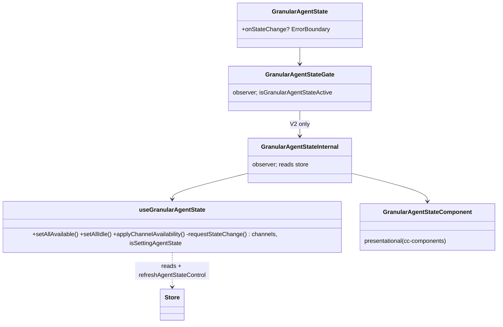

# granular-agent-state — SPEC

> **WXCC-15791.** This package is implemented. It consumes the SDK V2 surface, which must be published before release.

> Start here → root [`AGENTS.md`](../../../../AGENTS.md) (agent entry) · router [`SPEC_INDEX.md`](../../../../ai-docs/SPEC_INDEX.md) · system [`ARCHITECTURE.md`](../../../../ai-docs/ARCHITECTURE.md). This is the module's canonical spec: orientation, requirements, design, flows, state, UI, and tests.
> Context-efficiency: link to canonical docs — don't duplicate them. Load specs on demand per `SPEC_INDEX.md`.

## Metadata
| Field | Value |
|---|---|
| Module id | `granular-agent-state` |
| Status | Implemented |
| Source path(s) | `packages/contact-center/granular-agent-state/src/` |
| Doc kind | Module spec |
| Coverage score | Pending coverage assessment |
| Generated from | `module-spec` @ SDLC template library `0.1.0-draft` |
| generated_by / approved_by / updated_at | feature agent (WXCC-15791) / pending / 2026-09-29 |
| Validation status | unit tests pass |

Coverage score: `Pending coverage assessment` before the first report; after assessment, replace with `<0-100%>` plus the report path/evidence. Keep manifest coverage state outside the rendered module doc metadata (manifest: `DRAFT`).

## Evidence Rules
Every generated requirement below must cite concrete source evidence using `file path`. Separate source evidence, test evidence, examples, assumptions, and gaps so validators and future agents can distinguish truth from context. Test evidence is preferred for WHY. Commit evidence is allowed only when the repository policy says history is reliable, and must include the commit hash. If evidence is missing or conflicting, ask a focused discovery question before finalizing the requirement; record unresolved answers as approved unknowns only when the human explicitly defers or does not know.

## Source Material Register
| Source doc | Scope | Decision | Detail location or disposition |
|---|---|---|---|
| `packages/contact-center/granular-agent-state/src/` and `tests/` | source / tests | implemented layout | Requirements describe the implemented source/tests for this WXCC-15791 package (no archived docs). |
| wxcc-desktop `packages/agentx-mfe-wc-based/src/components/GranularStateSelector/` | UX reference | reference-only | Desktop-parity UI (pill, hover preview, menu, manage view) is modelled on it; not a source of truth for this repo. |

## Overview
`granular-agent-state` is the granular (V2) agent-state widget for the Webex Contact Center desktop. In a V2 session the agent has a separate state per channel (Voice/telephony, Chat, Email, Social); the widget shows the primary channel's state and timer on a header pill, previews every channel on hover, and lets the agent set all channels Available, set all channels Idle with an idle code, or toggle individual channels in a "Manage channel availability" view. All changes go through the SDK, which stays authoritative.

The SDK pins the routing version (V1 aggregate vs V2 per-channel) per login session. The store mirrors it as `store.isGranularAgentStateActive`; this widget renders `null` unless that is `true`, and the V1 `UserState` widget (`@webex/cc-user-state`) remains the control for V1 sessions. Its UI and interactions stay the same; the SDK response timestamp read is now guarded for response compatibility. The React sample app renders `GranularAgentState` when selected and `UserState` when selected and `!store.isGranularAgentStateActive` (`widgets-samples/cc/samples-cc-react-app/src/App.tsx`). The widget itself gates internally via `GranularAgentStateGate`. There is no widget-level flag.

The package follows the repo's one-directional layering: `GranularAgentState` (`src/granular-agent-state/index.tsx`) wraps an `observer` gate in an `ErrorBoundary`; the gate mounts `GranularAgentStateInternal`, which reads the store, calls the `useGranularAgentState` hook (`src/helper.ts`), and renders the presentational `GranularAgentStateComponent` from `@webex/cc-components`. A maintainer should start at `src/helper.ts` (all behaviour) and treat `index.tsx` as a thin gate → store → hook → component adapter.

## Purpose / Responsibility
Owns the V2 agent-state widget: gating on the V2 session flag, translating UI intents into per-channel `cc.setAgentState(...)` requests (skipping no-op channels), refreshing the store after success, the one-second channel timer tick, and the `onStateChange` callback. It does NOT own the V1/V2 decision, channel state storage, or SDK event wiring (`store/`), nor the presentation and pure view-model derivation (`cc-components` `GranularAgentState/`).

## Stack
TypeScript 5.6.3, React 18 (`react`/`react-dom` peer `>=18.3.1`), MobX via `mobx-react-lite` `^4.1.0`, `react-error-boundary` `^6.0.0`. Browser Web Worker API for the tick (inline Blob). Build: `tsc` for types + Webpack for the bundle (config mirrored from `user-state`). Tests: Jest 29 + React Testing Library; `jest.config.js` `testMatch` `**/granular-agent-state/tests/**`. Evidence: `packages/contact-center/granular-agent-state/package.json`.

## Folder / Package Structure
```
granular-agent-state/src/
├── index.ts                        # Package barrel — re-exports GranularAgentState
├── granular-agent-state.types.ts   # IGranularAgentStateProps + UseGranularAgentStateProps (Pick from cc-components IGranularAgentState)
├── helper.ts                       # useGranularAgentState hook + inline Web Worker tick script
└── granular-agent-state/
    └── index.tsx                   # GranularAgentState (ErrorBoundary) → GranularAgentStateGate → GranularAgentStateInternal
tests/
├── helper.ts                       # Hook behaviour + error-path tests
└── granular-agent-state/index.tsx  # Gate, render, ErrorBoundary tests
```
No `src/wc.ts` — custom-element registration lives only in `cc-widgets/src/wc.ts`.

## Key Files
| File | Holds |
|---|---|
| `packages/contact-center/granular-agent-state/src/helper.ts` | `useGranularAgentState`: worker tick, channel view models, `requestStateChange`, `setAllAvailable`, `setAllIdle`, `applyChannelAvailability`. All behaviour. |
| `packages/contact-center/granular-agent-state/src/granular-agent-state/index.tsx` | V2 gate, ErrorBoundary, which store fields are passed to the hook. |
| `packages/contact-center/granular-agent-state/src/granular-agent-state.types.ts` | Module prop contracts as `Pick`s of the canonical `IGranularAgentState`. |
| `packages/contact-center/cc-components/src/components/GranularAgentState/granular-agent-state.types.ts` | Canonical `IGranularAgentState`, `GranularAgentStateComponentProps`, `GranularStateChangePayload`, `SelectableChannelType` — do not redefine locally. |
| `packages/contact-center/cc-components/src/components/GranularAgentState/granular-agent-state.utils.ts` | `buildChannelStates`, `getSelectableChannelTypes`, `getChannelsToChange`, `getLastSetIdleCode` used by the hook. |

## Public Surface
| Contract ID | Type | Surface | Purpose | Compatibility / deprecation | Schema / detail link | Root index |
|---|---|---|---|---|---|---|
| `cc-widgets.GranularAgentState` | SDK (React export) | `GranularAgentState` React component (named export), prop `onStateChange?: (payload: GranularStateChangePayload) => void` where payload is `{state: 'Available' \| 'Idle', auxCodeId, channelTypes: SelectableChannelType[], idleCode?}` | Render the V2 agent-state widget and observe successful state changes | WXCC-15791; intended stable semver; adding optional props = minor, removing/renaming `onStateChange` or changing the payload = major | `packages/contact-center/granular-agent-state/src/index.ts`, props in `src/granular-agent-state.types.ts` | `../../../../ai-docs/CONTRACTS.md` |
| `cc-widgets.GranularAgentState` (custom element) | event | custom element `widget-cc-granular-agent-state` (registered in `cc-widgets`); `onStateChange` mapped as r2wc `function` | Mount the widget as a Web Component in a non-React host | WXCC-15791; tag name is part of the contract | `packages/contact-center/cc-widgets/src/wc.ts` (`{name: 'widget-cc-granular-agent-state', component: WebGranularAgentState}`) | `../../../../ai-docs/CONTRACTS.md` |

Compatibility notes:
- `onStateChange` fires once per successful SDK request. `applyChannelAvailability` may issue two requests (Available then Idle) and so may fire it twice.
- The widget renders nothing for V1 sessions; hosts must not rely on it to render `UserState` as a fallback.

## Requires (dependencies)
- `@webex/cc-store` (`workspace:*`) — reads `cc`, `agentId`, `idleCodes`, `channelStatesMap`, `logger`, `isGranularAgentStateActive`; calls `store.refreshAgentStateControl()` and `store.onErrorCallback`. SDK call: `cc.setAgentState(...)` with `channelType`. Store behaviour: [`store-spec.md`](../../store/ai-docs/store-spec.md) `STORE-R-040`..`STORE-R-042`.
- `@webex/cc-components` (`workspace:*`) — `GranularAgentStateComponent`, types, utils (`buildChannelStates`, `getChannelsToChange`, `getLastSetIdleCode`, `getSelectableChannelTypes`) and `AVAILABLE_AUX_CODE_ID` (`'0'`). Presentation: [`cc-components-spec.md`](../../cc-components/ai-docs/cc-components-spec.md) `CC-COMPONENTS-R-040`..`R-041`.
- `@webex/contact-center` SDK with the V2 surface (`getAgentStateControl`, `getChannelStates`, `setAgentState` `channelType`, `agent:channelStateChange` / `agent:channelStateChangeFailed` / `agent:channelReloginSuccess`), consumed only via the store. The currently published SDK lacks this surface; a V2-capable release is a prerequisite.
- `mobx-react-lite` `^4.1.0`, `react-error-boundary` `^6.0.0`, browser Web Worker API. Peer: `react` / `react-dom` `>=18.3.1`.

## Requirements
| ID | WHAT | WHY | Source Evidence | Test / Example Evidence | Assumptions / Gaps | Confidence |
|---|---|---|---|---|---|---|
| `GRANULAR-AGENT-STATE-R-001` | `GranularAgentStateGate` (observer) renders `GranularAgentStateInternal` only when `store.isGranularAgentStateActive`; otherwise `null`, so the hook (worker, SDK calls) never runs for V1 sessions. | The SDK pins V1/V2 per session; V1 sessions use `UserState`, and a V2 request in a V1 session is invalid. | `src/granular-agent-state/index.tsx` | `tests/granular-agent-state/index.tsx` "should render nothing and not start the hook for V1 sessions" | none | Implemented |
| `GRANULAR-AGENT-STATE-R-002` | `GranularAgentStateInternal` passes `cc`, `agentId`, `idleCodes`, `channelStatesMap`, `logger`, `onStateChange` to `useGranularAgentState` and spreads its result plus `logger` into `GranularAgentStateComponent`. | Store-driven, props-only presentation. | `src/granular-agent-state/index.tsx` | `tests/granular-agent-state/index.tsx` "should render the granular component with store data for V2 sessions" | none | Implemented |
| `GRANULAR-AGENT-STATE-R-003` | Render errors are contained by an `ErrorBoundary` (empty fallback) that calls `store.onErrorCallback('GranularAgentState', error)`. | A widget crash must not take down the host. | `src/granular-agent-state/index.tsx` | `tests/granular-agent-state/index.tsx` "should report render errors through onErrorCallback" | none | Implemented |
| `GRANULAR-AGENT-STATE-R-004` | A Blob Web Worker posts `{type: 'tick', now}` every 1s after `start`; the hook stores `now` and recomputes `channels = buildChannelStates(channelStatesMap, idleCodes, now)`; on unmount it posts `stop`, calls `terminate()` and nulls the ref. Worker init failure is caught and logged (`Error initializing worker`). | Accurate per-channel timers while the tab is backgrounded; no leaked workers. | `src/helper.ts` (`TICK_WORKER_SCRIPT`, init `useEffect`) | `tests/helper.ts` "should start a worker tick and terminate it on unmount", "should update elapsed time on each worker tick" | No test for the worker-init catch branch. | Implemented |
| `GRANULAR-AGENT-STATE-R-005` | The hook returns `{idleCodes, channels, primaryChannel: channels[0], setAllAvailable, setAllIdle, applyChannelAvailability, isSettingAgentState}`. Primary channel is the first of `telephony`, `chat`, `email`, `social` that has a state and capacity. | Pill shows the highest-priority channel, matching desktop order. | `src/helper.ts`; `cc-components` `granular-agent-state.utils.ts` (`CHANNEL_ORDER`) | `tests/helper.ts` "should build channel view models with the first channel as primary" | none | Implemented |
| `GRANULAR-AGENT-STATE-R-006` | `requestStateChange(state, auxCodeId, channelTypes, idleCode?)`: when `channelTypes` is empty it logs info and resolves without an SDK call; otherwise sets `isSettingAgentState` true and calls `cc.setAgentState({state, auxCodeId, agentId, lastStateChangeReason: idleCode?.name ?? state, channelType: channelTypes})`; on success calls `store.refreshAgentStateControl()` then `onStateChange?.({state, auxCodeId, channelTypes, idleCode})`; on failure logs `CC-Widgets: GranularAgentState: Error setting agent state - <err>` (module `useGranularAgentState`) without rethrow; `isSettingAgentState` resets in `finally`. | SDK routes `channelType` to V2 PUT `/v2/agents/session/state`; skipping no-ops avoids needless requests; refresh picks up the new state even before the event arrives. | `src/helper.ts` (`requestStateChange`) | `tests/helper.ts` for successful requests, no-op skip, and rejected SDK calls | Set-all menu request failures have no in-widget error surface; Manage Apply catches failures and displays an error banner while retaining the panel and draft. | Implemented |
| `GRANULAR-AGENT-STATE-R-007` | `setAllAvailable()` requests `'Available'` / auxCodeId `'0'` for `getChannelsToChange(map, selectable, 'Available', '0')`; `setAllIdle(idleCode)` requests `'Idle'` / `idleCode.id` (reason = idle code name) for `getChannelsToChange(map, selectable, 'Idle', idleCode.id)`. `selectable = getSelectableChannelTypes(channelStatesMap)`. | Only channels not already in the target state are sent; pending-idle channels are re-sent to Available. | `src/helper.ts` | `tests/helper.ts` "should set only non-available channels Available...", "should set all channels Idle with the chosen idle code as reason" | none | Implemented |
| `GRANULAR-AGENT-STATE-R-008` | `applyChannelAvailability(availability)` splits the changed-channels map into switched-on and switched-off lists; sends one Available request for the on-list, THEN one Idle request for the off-list using `getLastSetIdleCode(channelStatesMap, idleCodes)` (most recent channel idle code → default idle code → first selectable). If no idle code exists it logs `no idle code available to switch channels off` and skips the Idle request. While those requests update the SDK map, the manage view merges the new baseline while retaining unconfirmed draft choices. | The manage view has no reason picker; desktop reuses the last applied idle code. Sequential requests keep SDK state consistent without losing unsent choices if the later request fails. | `src/helper.ts` (`applyChannelAvailability`); `cc-components/src/components/GranularAgentState/manage-channel-availability.tsx` | `tests/helper.ts` "should apply per-channel availability as one request per target state using the last idle code", "should fall back to the default idle code when switching channels off with none idle"; `cc-components/tests/components/GranularAgentState/granular-agent-state.tsx` partial-apply state update | No test for the "no idle code at all" branch. | Implemented |

## Design Overview
Three nested components keep the gate cheap: `GranularAgentState` (ErrorBoundary) → `GranularAgentStateGate` (observer reading only `isGranularAgentStateActive`) → `GranularAgentStateInternal` (observer reading the channel maps and calling the hook). Because hooks only run inside `Internal`, a V1 session never creates the worker.

All behaviour is in `useGranularAgentState` (`src/helper.ts`): one mount effect owns the tick worker; every render rebuilds `channels` from the store maps and the latest tick (`buildChannelStates` is pure, in `cc-components`); action functions compute target channels with `getChannelsToChange` and funnel through a single `requestStateChange`. Unlike V1 `useUserState`, there is no optimistic store write and no revert: the SDK is called directly (`cc.setAgentState` with `channelType`, same access pattern as V1) and the store is re-read (`refreshAgentStateControl`) on success; `agent:channelStateChange` also triggers a store refresh. There is no store action for V2 changes.

## Data Flow
In-process React/MobX with a Web Worker sidecar; the only network boundary is the SDK call.

```mermaid
graph TB
    subgraph Presentation
        Gate[GranularAgentStateGate<br/>observer · isGranularAgentStateActive]
        Widget[GranularAgentStateInternal<br/>observer]
        Comp[GranularAgentStateComponent<br/>@webex/cc-components]
    end
    Hook[useGranularAgentState<br/>helper.ts]
    Worker[Web Worker<br/>inline Blob · 1s tick]
    Store[Store singleton<br/>@webex/cc-store]
    SDK[Contact Center SDK]

    Store -->|isGranularAgentStateActive| Gate
    Gate -->|V2 only| Widget
    Store -->|cc, agentId, idleCodes,<br/>channelStatesMap| Widget
    Widget --> Hook
    Hook <-->|start/stop · tick now| Worker
    Hook -->|setAgentState channelType| SDK
    Hook -->|refreshAgentStateControl| Store
    SDK -->|agent:channelStateChange| Store
    Hook -->|channels, primaryChannel, actions| Widget
    Widget --> Comp
    Comp -->|setAllAvailable / setAllIdle / applyChannelAvailability| Hook
```

## Sequence Diagram(s)
Sequence coverage:

| Operation group | Diagram | Failure / recovery coverage |
|---|---|---|
| Set all / apply per-channel availability | "Granular state change" | no-op skip; SDK reject → log, busy flag reset; no idle code → skip Idle request |
| V1/V2 gating | covered by Data Flow + `GRANULAR-AGENT-STATE-R-001` | V1 → `null` |

```mermaid
sequenceDiagram
    actor Agent
    participant Comp as GranularAgentStateComponent
    participant Hook as useGranularAgentState
    participant SDK
    participant Store

    Agent->>Comp: Manage channel availability → toggle → Apply
    Comp->>Hook: applyChannelAvailability({chat: true, email: false})
    Hook->>Hook: getLastSetIdleCode(map, idleCodes)
    Hook->>SDK: setAgentState({state:'Available', auxCodeId:'0', channelType:['chat'], ...})
    alt success
        SDK-->>Hook: resolved
        Hook->>Store: refreshAgentStateControl()
        Hook->>Hook: onStateChange({state:'Available', channelTypes:['chat']})
    else rejected
        SDK-->>Hook: error
        Hook->>Hook: logger.error("Error setting agent state - ...")
    end
    alt idle code found
        Hook->>SDK: setAgentState({state:'Idle', auxCodeId: code.id, lastStateChangeReason: code.name, channelType:['email']})
        SDK-->>Hook: resolved / rejected (same handling)
    else none
        Hook->>Hook: logger.error("no idle code available ..."); skip
    end
    SDK-->>Store: agent:channelStateChange → refreshAgentStateControl()
    Store-->>Comp: new channelStatesMap → re-render
```

## Class / Component Relationships


## Use Cases
- **UC-1 Set all channels Available:** menu → "Set as Available (all channels)" → `setAllAvailable()` → one request for channels not already Available (or pending idle). Evidence: `src/helper.ts`, `tests/helper.ts`.
- **UC-2 Set all channels Idle:** menu → pick a selectable idle code → `setAllIdle(code)` → one Idle request with reason = code name. The menu and manage-view fallback exclude Available, error-triggering system codes (for example RONA), and the platform ENGAGED code. Evidence: `cc-components/src/components/GranularAgentState/granular-agent-state.utils.ts`, `cc-components/tests/components/GranularAgentState/granular-agent-state.utils.tsx`, `src/helper.ts`, `tests/helper.ts`.
- **UC-3 Toggle individual channels:** "Manage Channel Availability" → toggles → Apply → `applyChannelAvailability(changed)` → Available request, then Idle request with last-set idle code. Evidence: `src/helper.ts`, `tests/helper.ts`.
- **UC-4 V1 session:** `isGranularAgentStateActive` false → widget renders nothing; host shows `UserState`. Evidence: `src/granular-agent-state/index.tsx`, `tests/granular-agent-state/index.tsx`.
- **UC-5 Automatic V1/V2 in the sample:** the React sample independently selects widgets via checkboxes; `GranularAgentState` renders when selected (it self-gates via `GranularAgentStateGate` on `store.isGranularAgentStateActive`) and `UserState` renders when selected and `!store.isGranularAgentStateActive`. The session version is pinned from the agent profile's `manageChannelAvailability`. Evidence: `widgets-samples/cc/samples-cc-react-app/src/App.tsx`.

## UI Flow
Presentation is owned by `cc-components`; summary: pill (`granular-state-pill`) with primary channel avatar, `"<displayState> - <formatTime(elapsed)>"`, secondary channel avatars and chevron; hover preview (`granular-state-preview`); click opens `granular-state-panel` with the menu (`granular-state-menu`: search, multi-channel block, idle list `granular-state-idle-code-<id>`) or the manage view (`manage-channel-availability`, toggles `manage-channel-availability-toggle-<all|channel>`, Apply/Cancel/Back). All actions are disabled while `isSettingAgentState`. Renders nothing when there is no primary channel or for V1 sessions. Labels are English-only constants (`granularAgentStateLabels`).

## State Model
Hook-local React state (`src/helper.ts`): `isSettingAgentState: boolean` (true for the duration of a request), `now: number` (last worker tick), `workerRef: Worker | null`. Derived per render: `channels: ChannelStateInfo[]`, `primaryChannel`. Domain state (`channelStatesMap`, `agentStateControlStatus`) is owned by the store and only re-read, never written, by this module.

## Error Handling & Failure Modes
| Condition | Signal (error/code/result) | Caller recovery |
|---|---|---|
| `cc.setAgentState` rejects | `logger.error("CC-Widgets: GranularAgentState: Error setting agent state - <err>")`; `onStateChange` not called; busy flag reset; a following Idle request is not sent and the panel stays open | Store state unchanged; agent retries. The store logs `agent:channelStateChangeFailed` and refreshes. |
| No channels need changing | info log `channels already <state>, skipping request`; no SDK call | None |
| Manage view switches a channel off but no selectable idle code exists | `logger.error('... no idle code available to switch channels off')`; Idle request skipped | Configure idle codes |
| Worker cannot be created | `logger.error('... Error initializing worker')` | Timers stay at initial values; no crash |
| Render error | ErrorBoundary empty fallback + `store.onErrorCallback('GranularAgentState', error)` | Host decides UX |
| Throw inside a component action | `cc-components` logs `Error in <method>` and closes the panel | None |

## Pitfalls
- **Do not add a widget flag or gate on profile settings.** The only gate is `store.isGranularAgentStateActive`; there is no `isGranularStateChangeEnabled` / `manageChannelAvailability` store field.
- **Mount one of `UserState` / `GranularAgentState`.** `UserState` is not V2-aware; mounting both in a V2 session renders two controls.
- **`applyChannelAvailability` is two requests.** The Idle request is chained after the Available one resolves or fails; `onStateChange` can fire twice.
- **SDK dependency.** The V2 surface is not in the published SDK used by `store/package.json`; unit tests must mock it. Package `test:unit` runs `tsc --project tsconfig.test.json` first; if the store is portal-linked to a local SDK build, that pre-step sees duplicate SDK type copies, so run jest directly (environment issue, not a code defect).

## Module Do's / Don'ts
- DO: route V2 state changes through `requestStateChange` and refresh the store on success.
- DO: keep view-model derivation in `cc-components` utils; the hook only orchestrates.
- DON'T: write `channelStatesMap` or `agentStateControlStatus` from the widget — they mirror the SDK.
- DON'T: redefine prop types locally — `Pick` from `IGranularAgentState`.

## Host Integration & Theming
Consumed as the React `GranularAgentState` export (directly or via `@webex/cc-widgets`) or as the `widget-cc-granular-agent-state` custom element registered by `cc-widgets`. Requires an initialized store. Host selects V1/V2: `store.isGranularAgentStateActive ? <GranularAgentState onStateChange={...}/> : <UserState onStateChange={...}/>`. Theming uses Momentum Design tokens in `cc-components` (`granular-agent-state.scss`). Peer React `>=18.3.1`.

## Test-Case Strategy (module)
Tests ship with the package and pass. `tests/helper.ts` uses `renderHook` with a mocked `Worker` and `cc.setAgentState`, covering view models, worker lifecycle and ticks, available/idle payloads, no-op skip, SDK rejection, and per-channel apply with last/default idle code. `tests/granular-agent-state/index.tsx` covers V2 rendering with store data, V1 `null` without starting the hook, and ErrorBoundary reporting. Line coverage target: >= 90%. Run with `NODE_ENV=test yarn workspace @webex/cc-granular-agent-state exec jest`.

| Behavior / Requirement | Test cases | Gap |
|---|---|---|
| `GRANULAR-AGENT-STATE-R-001` | `tests/granular-agent-state/index.tsx` (V1 renders nothing) | none |
| `GRANULAR-AGENT-STATE-R-002` | `tests/granular-agent-state/index.tsx` (V2 render with store data) | none |
| `GRANULAR-AGENT-STATE-R-003` | `tests/granular-agent-state/index.tsx` (onErrorCallback) | none |
| `GRANULAR-AGENT-STATE-R-004` | `tests/helper.ts` (worker start/terminate, tick) | worker-init failure branch |
| `GRANULAR-AGENT-STATE-R-005` | `tests/helper.ts` (primary channel) | none |
| `GRANULAR-AGENT-STATE-R-006` | `tests/helper.ts` (success notify, skip, reject) | none |
| `GRANULAR-AGENT-STATE-R-007` | `tests/helper.ts` (set available / idle) | none |
| `GRANULAR-AGENT-STATE-R-008` | `tests/helper.ts` (apply with last / default idle code) | no-idle-code branch |

## Known Gaps
- Playwright E2E and Web Component sample app (`samples-cc-wc-app`) updates are out of scope for this plan (follow-up).
- No i18n — labels are English constants in `cc-components` `GranularAgentState/constant.ts`.
- WebRTC-disconnect handling (desktop disables Available/telephony toggle) is out of scope for this plan.
- `pendingIdle` UX, RONA dialogs, supervisor/TPW out of scope.
- Idle codes come from `store.idleCodes` client-side (no paginated fetch / 3-char search minimum as in desktop).
- Set-all menu request failures are logged without an in-widget error message. Manage Apply failures show an error banner and preserve the draft.
- Requires a published SDK with the V2 surface and a store dependency bump; browser verification against a real V2 tenant is deferred to follow-up.

## Traceability
- Repo architecture: `../../../../ai-docs/ARCHITECTURE.md` · Registry: `../../../../ai-docs/SPEC_INDEX.md` · Contracts: `../../../../ai-docs/CONTRACTS.md`
- Related specs: [`store-spec.md`](../../store/ai-docs/store-spec.md), [`cc-components-spec.md`](../../cc-components/ai-docs/cc-components-spec.md), [`cc-widgets-spec.md`](../../cc-widgets/ai-docs/cc-widgets-spec.md), [`user-state-spec.md`](../../user-state/ai-docs/user-state-spec.md)
- Coverage state & contracts baseline: `.sdd/manifest.json` (`granular-agent-state`); implemented
